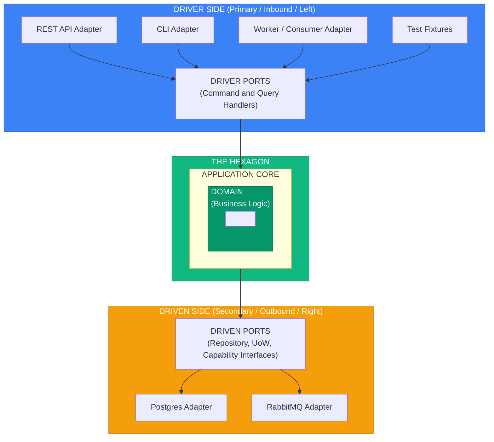

# Hexagonal Architecture (Ports & Adapters)

> Sources:
> - [Hexagonal Architecture](https://alistair.cockburn.us/hexagonal-architecture/) — Alistair Cockburn (2005)
> - [Hexagonal Architecture Explained](https://openlibrary.org/works/OL38388131W) — Alistair Cockburn & Juan Manuel Garrido de Paz (2024)
> - [Interview with Alistair Cockburn](https://jmgarridopaz.github.io/content/interviewalistair.html) — Juan Manuel Garrido de Paz
> - [Hexagonal Architecture Pattern](https://docs.aws.amazon.com/prescriptive-guidance/latest/cloud-design-patterns/hexagonal-architecture.html) — AWS

## Core Concept

> "Allow an application to equally be driven by users, programs, automated tests, or batch scripts, and to be developed and tested in isolation from its eventual run-time devices and databases."
> — Alistair Cockburn

**Design validation technique:** The pattern was designed with FIT testing in mind—business experts can write test cases before any GUI exists. If you can run your entire application from test fixtures, your hexagonal boundaries are correct.

**The hexagon is conceptual.** Most applications have 2-4 ports, not six. The shape emphasizes that all external interactions go through ports, regardless of direction.

**Drivers are equals.** A REST API, a CLI, a worker, and a test suite drive the same
handlers. None of them is "the" entry point, and adding one never changes the hexagon.



---

## Ports

Interfaces defining how the application communicates with the outside world. Examples
use the context `ordering`, the aggregate `Order`, and the package root `app`; full
bodies of the write side are in [layers](layers.md).

### Driver Ports (Primary / Inbound)

Define **how the world uses your application**. In this skill, these are **command and
query handlers** implementing the `IHandler` protocol. Do not add an
`application/ports/inbound/` package merely to mirror hexagonal terminology.

```python
# app/shared_kernel/application/handlers/i_handler.py
from typing import Protocol


class IHandler[TAction, TResult](Protocol):
    """Generic handler protocol for commands and queries."""

    async def handle(self, action: TAction) -> TResult: ...


# app/bounded_context/ordering/application/handlers/commands/place_order_handler.py
# (signature; PlaceOrderLine and the body are in layers.md)
from collections.abc import Callable
from uuid import UUID

from app.bounded_context.ordering.application.dtos.order_dto import OrderDTO
from app.bounded_context.ordering.application.ports.transactions import IOrderingUnitOfWork
from app.shared_kernel.application.handlers import IHandler
from app.utils import FrozenObject


class PlaceOrderCommand(FrozenObject):
    customer_id: UUID
    currency: str
    lines: tuple[PlaceOrderLine, ...]


class PlaceOrderHandler(IHandler[PlaceOrderCommand, OrderDTO]):
    def __init__(self, uow_factory: Callable[[], IOrderingUnitOfWork]) -> None: ...

    async def handle(self, action: PlaceOrderCommand) -> OrderDTO: ...
```

The `Command` (or `Query`) is the handler's input contract and lives in its file. The
handler's output contract is a DTO, never an entity, value object, or ORM model.

### Driven Ports (Secondary / Outbound)

Define **how your application uses external systems**. They use `abc.ABC` and speak
domain types or DTOs, never ORM models or SDK types.

| Port | Owner and location | Speaks |
| --- | --- | --- |
| Write repository `IOrderRepository` | domain: `domain/repositories/i_order_repository.py` | entities and value objects |
| Read repository `IOrderReadRepository` | application: `application/ports/read_repositories/i_order_read_repository.py` | DTOs |
| Unit of Work `IOrderingUnitOfWork` | application: `application/ports/transactions/i_ordering_unit_of_work.py` | write repositories, commit, rollback |
| Other capability `IPaymentGateway` | application: `application/ports/<capability>/i_<capability>.py` | DTOs or value objects |

The write repository lives in the domain because its contract protects aggregate
invariants; `IOrderRepository` and `IOrderingUnitOfWork` are shown in full in
[layers](layers.md#example-repository-interface). The read side:

```python
# app/bounded_context/ordering/application/ports/read_repositories/i_order_read_repository.py
import abc
from uuid import UUID

from app.bounded_context.ordering.application.dtos.order_dto import OrderDTO, OrderPageDTO
from app.bounded_context.ordering.domain.enums.order_status_enum import OrderStatusEnum


class IOrderReadRepository(abc.ABC):
    @abc.abstractmethod
    async def get_by_id(self, order_id: UUID) -> OrderDTO | None: ...

    @abc.abstractmethod
    async def find_by_status(self, status: OrderStatusEnum) -> list[OrderDTO]: ...

    @abc.abstractmethod
    async def list_page(self, *, page: int = 1, per_page: int = 10) -> OrderPageDTO: ...
```

---

## Adapters

Concrete implementations that connect ports to external technologies.

### Driver Adapters (Primary / Inbound)

A driver adapter receives input in its own technology, parses it into the handler's
`Command` or `Query`, calls a handler it received from the composition root, and builds
its output model from the returned DTO (`Model.model_validate(dto)`). Errors are
translated at its edge according to the [error model](../errors/error-model.md). It holds
no business rule, transaction boundary, or storage query. Every driver follows the
[interface adapter contract](../interfaces/adapter-contract.md); framework code lives in
its interface skill.

| Driver | Receives | Returns | Lives in | Skill |
| --- | --- | --- | --- | --- |
| REST API | HTTP request | response model | `interfaces/api/` | `ddd-interface-fastapi` |
| CLI | arguments, options, stdin | rendered response and exit code | `interfaces/cli/` | `ddd-interface-cli` |
| Worker / consumer | message or schedule tick | acknowledgement, retry, or dead-letter | `interfaces/<kind>/` | `ddd-interface-<kind>` |
| Context-scoped driver (scheduler, webhook ACL) | payload owned by one context | handler call | `bounded_context/<context>/infrastructure/inbound/<driver>/` | this skill |
| Test | fixture | assertions on the DTO | `tests/` | [testing strategy](../testing/strategy.md) |

Process-level delivery mechanisms that serve the whole service live in
`interfaces/<kind>/`; drivers that belong to one context live in that context's
`infrastructure/inbound/`.

### Driven Adapters (Secondary / Outbound)

Implement port interfaces using specific technologies like SQLAlchemy. They live in
`infrastructure/outbound/<capability>/`, end in `Adapter`, and translate their driver's
errors into typed `InfrastructureException` subclasses. The write repository adapter
(`SqlOrderRepositoryAdapter`), its `OrderMapper`, the `OrderModel`, and the Unit of Work
adapter (`SqlOrderingUnitOfWorkAdapter`) are shown in
[layers](layers.md#infrastructure-layer). The read repository adapter maps ORM rows
straight to DTOs:

```python
# app/bounded_context/ordering/infrastructure/outbound/persistence/repositories/sql_order_read_repository_adapter.py
from uuid import UUID

from sqlalchemy import func, select
from sqlalchemy.ext.asyncio import AsyncSession, async_sessionmaker

from app.bounded_context.ordering.application.dtos.order_dto import OrderDTO, OrderPageDTO
from app.bounded_context.ordering.application.ports.read_repositories import (
    IOrderReadRepository,
)
from app.bounded_context.ordering.domain.enums.order_status_enum import OrderStatusEnum
from app.bounded_context.ordering.infrastructure.outbound.persistence.mappers.read_mappers.order_read_mapper import (
    OrderReadMapper,
)
from app.bounded_context.ordering.infrastructure.outbound.persistence.models.order_model import (
    OrderModel,
)


class SqlOrderReadRepositoryAdapter(IOrderReadRepository):
    """Read-optimized adapter for queries; no entity is rebuilt."""

    def __init__(self, session_factory: async_sessionmaker[AsyncSession]) -> None:
        self._session_factory = session_factory

    async def get_by_id(self, order_id: UUID) -> OrderDTO | None:
        async with self._session_factory() as session:
            row = await session.get(OrderModel, order_id)
            return OrderReadMapper.to_dto(row) if row is not None else None

    async def find_by_status(self, status: OrderStatusEnum) -> list[OrderDTO]:
        async with self._session_factory() as session:
            rows = await session.scalars(
                select(OrderModel).where(OrderModel.status == status.value)
            )
            return [OrderReadMapper.to_dto(row) for row in rows]

    async def list_page(self, *, page: int = 1, per_page: int = 10) -> OrderPageDTO:
        async with self._session_factory() as session:
            total = await session.scalar(select(func.count()).select_from(OrderModel)) or 0
            rows = await session.scalars(
                select(OrderModel)
                .order_by(OrderModel.created_at)
                .limit(per_page)
                .offset((page - 1) * per_page)
            )
            items = tuple(OrderReadMapper.to_dto(row) for row in rows)

        return OrderPageDTO(items=items, page=page, per_page=per_page, total=total)
```

A provider adapter for another capability has the same shape: it implements
`IPaymentGateway`, lives in `infrastructure/outbound/payments/`, is named after the
provider (`StripePaymentGatewayAdapter`), and turns SDK errors into typed errors.

---

## Connecting Ports to Adapters

There is no DI container and no framework-specific wiring inside the hexagon. The
[composition root](composition-root.md) is the only code that sees a port and its
adapter together: it reads settings, builds the adapters, injects them into handlers, and
hands the handlers to the interface. Handlers receive ports as constructor parameters, so
any driver — and any test — supplies its own implementations.

```python
# app/bootstrap/ordering.py (continued) — or interfaces/<kind>/bootstrap.py while
# only one interface exists. build_ordering() is shown in composition-root.md.
from functools import partial

from sqlalchemy.ext.asyncio import AsyncEngine, async_sessionmaker

from app.bounded_context.ordering.infrastructure.outbound.persistence.ordering_unit_of_work_adapter import (
    SqlOrderingUnitOfWorkAdapter,
)
from app.bounded_context.ordering.infrastructure.outbound.persistence.repositories.sql_order_read_repository_adapter import (
    SqlOrderReadRepositoryAdapter,
)


def build_ordering_with_sql(engine: AsyncEngine) -> OrderingHandlers:
    session_factory = async_sessionmaker(engine, expire_on_commit=False)
    return build_ordering(
        uow_factory=partial(SqlOrderingUnitOfWorkAdapter, session_factory),
        read_repository=SqlOrderReadRepositoryAdapter(session_factory),
    )
```

The API, the CLI, and a worker all obtain their handlers from this function; each
interface decides only *when* it runs (per process, per request, per invocation) and how
it publishes them to its own state. Tests skip the composition root and pass fakes:

```python
# tests/unit/bounded_context/ordering/application/test_place_order_handler.py
from decimal import Decimal
from uuid import uuid4

from app.bounded_context.ordering.application.handlers.commands.place_order_handler import (
    PlaceOrderCommand,
    PlaceOrderHandler,
    PlaceOrderLine,
)
from app.bounded_context.ordering.domain.enums.order_status_enum import OrderStatusEnum
from tests.fakes.ordering import FakeOrderingUnitOfWork  # in-memory IOrderingUnitOfWork


async def test_place_order_returns_a_placed_order() -> None:
    uow = FakeOrderingUnitOfWork()
    handler = PlaceOrderHandler(lambda: uow)
    line = PlaceOrderLine(product_id=uuid4(), quantity=1, unit_price=Decimal("10.00"))

    order = await handler.handle(
        PlaceOrderCommand(customer_id=uuid4(), currency="EUR", lines=(line,))
    )

    assert order.status == OrderStatusEnum.PLACED
    assert uow.committed
```

No driver, database, or patching is needed: the application runs from test fixtures,
which is Cockburn's validation of the boundaries.

---

## Naming Conventions

Names agree with the [project topology](project-topology.md#naming), which is
authoritative for files and classes. Interface-specific names (HTTP schemas, CLI
responses, dependency providers) are defined by the interface skills.

| Component | Pattern | Example |
|-----------|---------|---------|
| Write repository port | `I<Aggregate>Repository` | `IOrderRepository` |
| Read repository port | `I<Name>ReadRepository` | `IOrderReadRepository` |
| Write repository adapter | `<Technology><Aggregate>RepositoryAdapter` | `SqlOrderRepositoryAdapter` |
| Read repository adapter | `<Technology><Name>ReadRepositoryAdapter` | `SqlOrderReadRepositoryAdapter` |
| Unit of Work port | `I<Context>UnitOfWork` | `IOrderingUnitOfWork` |
| Unit of Work adapter | `<Technology><Context>UnitOfWorkAdapter` | `SqlOrderingUnitOfWorkAdapter` |
| Other outbound port | `I<Capability>` | `IPaymentGateway` |
| Other outbound adapter | `<Provider><Capability>Adapter` | `StripePaymentGatewayAdapter` |
| Command | `<Verb><Noun>Command` | `PlaceOrderCommand` |
| Query | `<Verb><Noun>Query` | `GetOrderQuery` |
| Handler | `<Verb><Noun>Handler` | `PlaceOrderHandler` |
| DTO | `<Name>DTO` | `OrderDTO` |
| Assembler (Entity/VO → DTO) | `<Aggregate>Assembler` | `OrderAssembler` |
| ORM model | `<Table>Model` | `OrderModel` |
| Persistence mapper (ORM ↔ Entity) | `<Aggregate>Mapper` | `OrderMapper` |
| Read mapper (ORM → DTO) | `<Name>ReadMapper` | `OrderReadMapper` |
| Domain event | `<Fact>Event` | `OrderPlacedEvent` |
| Enum | `<Name>Enum` | `OrderStatusEnum`, `PaymentStatusEnum` |
| Exception | concrete `<Name>Error`, bases `<Category>Exception` | `OrderNotFoundError`, `DomainException` |

**Every concrete infrastructure class ends in `Adapter`.** An application service says
*what* to orchestrate through abstract contracts; an adapter says *how* to talk to one
concrete dependency. `SqlOrderRepositoryAdapter` is valid; `OrderRepository`,
`SQLAlchemyOrderUoW`, and `OrderService` below `infrastructure/` are not.

**Enum suffix is mandatory, no exception.** A class deriving from `Enum`/`StrEnum`/
`IntEnum`/`(str, Enum)` must end in `Enum` — the reader must be able to tell it's an
enumeration from the name alone at the call site (`OrderStatusEnum.PLACED`), without
opening the file to check whether `OrderStatus` is an Enum, a Value Object, or a plain
class. This applies to every enum in the project, from domain status enums to any future
one.

### Project Structure

The canonical context-first tree is in the [project topology](project-topology.md#layout);
the files used by these examples are mapped in [layers](layers.md#project-structure).
In short: ports live in `domain/repositories/` and `application/ports/`, driven adapters
in `infrastructure/outbound/`, context-scoped drivers in `infrastructure/inbound/`, and
process-level drivers in `interfaces/<kind>/`.

---

## Benefits

1. **Testability** - Swap real adapters for test doubles
2. **Flexibility** - Change technologies without changing core
3. **Independence** - Develop core without external systems
4. **Clear boundaries** - Explicit interfaces between layers
5. **Parallel development** - Teams work on different adapters
6. **Many drivers, one core** - An API, a CLI, a worker, and tests run the same handlers

---

## Review Checklist

- [ ] The application can be driven entirely from test fixtures; an API, a CLI, and a worker call the same handlers.
- [ ] Driver ports are command and query handlers; there is no `application/ports/inbound/` package.
- [ ] Driven ports have the prescribed owner: write repositories in `domain/repositories/`, read repositories in `application/ports/read_repositories/`, the Unit of Work in `application/ports/transactions/`, other capabilities in `application/ports/<capability>/`.
- [ ] Ports speak domain types or DTOs, never ORM models, SDK types, or framework objects.
- [ ] Driver adapters only translate input, call handlers, and build output models from DTOs; they follow the interface adapter contract.
- [ ] Driven adapters live in `infrastructure/outbound/` (or a mixed subsystem), end in `Adapter`, and translate native errors into typed `InfrastructureException` subclasses.
- [ ] Only the composition root pairs ports with adapters; tests substitute fakes through constructor parameters, without patching.
- [ ] Names match the project topology table, including `I<Context>UnitOfWork` / `<Technology><Context>UnitOfWorkAdapter` and the mandatory `Enum` suffix.
