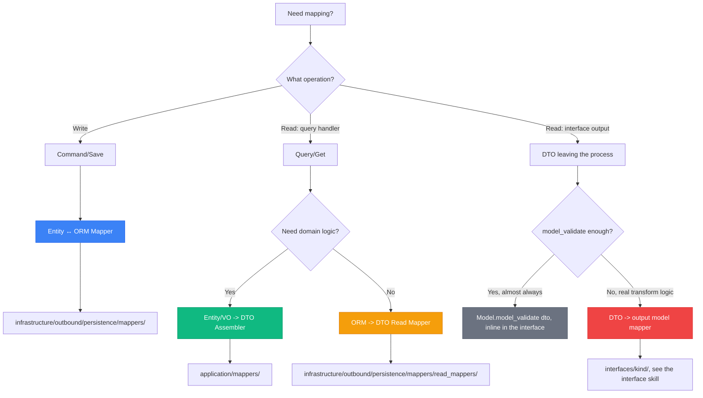
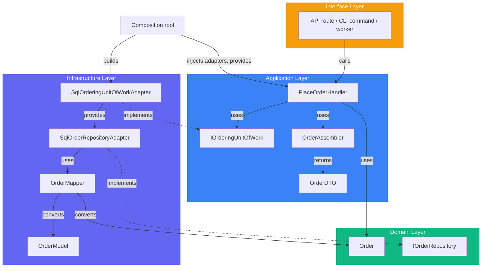

# Layer Structure - Complete Reference

> Sources:
> - [The Clean Architecture](https://blog.cleancoder.com/uncle-bob/2012/08/13/the-clean-architecture.html) — Robert C. Martin
> - [Designing a DDD-oriented Microservice](https://learn.microsoft.com/en-us/dotnet/architecture/microservices/microservice-ddd-cqrs-patterns/ddd-oriented-microservice) — Microsoft
> - [Clean Architecture: Standing on the Shoulders of Giants](https://herbertograca.com/2017/09/28/clean-architecture-standing-on-the-shoulders-of-giants/) — Herberto Graça

## The Four Layers

| Layer | Responsibility | Dependencies |
|-------|---------------|--------------|
| **Domain** | Business logic, entities, rules | None (pure) |
| **Application** | Use cases, orchestration, outbound port contracts | Domain |
| **Infrastructure** | Concrete adapters for databases, brokers, SDKs, external services | Application, Domain |
| **Interface** | Delivery adapters: API, CLI, worker, message consumer | Application |

Wiring sits outside the four layers. The [composition root](composition-root.md) is the
only code that knows both a port and its concrete adapter: it builds adapters, injects
them into handlers, and hands the handlers to the interface.

The layers are identical whatever drives the application. An API, a CLI, and a worker
differ only inside `interfaces/<kind>/`.

---

## Project Structure

The canonical layout, placement rules, and naming table are in the
[project topology](project-topology.md). The examples in this file use the context
`ordering`, the aggregate `Order`, and the package root `app`, and map to these files:

```text
app/
├── exceptions/ordering_errors.py
├── utils/                                         # FrozenObject
├── shared_kernel/
│   ├── domain/value_objects/value_object.py       # ValueObject base
│   └── application/handlers/i_handler.py          # IHandler protocol
├── bounded_context/ordering/
│   ├── domain/
│   │   ├── entities/order.py                      # Order, OrderItem
│   │   ├── value_objects/{order_id,customer_id,money}.py
│   │   ├── enums/order_status_enum.py
│   │   └── repositories/i_order_repository.py
│   ├── application/
│   │   ├── dtos/order_dto.py                      # OrderDTO, OrderPageDTO
│   │   ├── handlers/commands/place_order_handler.py
│   │   ├── handlers/queries/get_order_handler.py
│   │   ├── mappers/order_assembler.py
│   │   └── ports/
│   │       ├── read_repositories/i_order_read_repository.py
│   │       └── transactions/i_ordering_unit_of_work.py
│   └── infrastructure/outbound/persistence/
│       ├── models/base.py                         # OrderingBase
│       ├── models/order_model.py
│       ├── mappers/order_mapper.py
│       ├── mappers/read_mappers/order_read_mapper.py
│       ├── repositories/sql_order_repository_adapter.py
│       ├── repositories/sql_order_read_repository_adapter.py
│       └── ordering_unit_of_work_adapter.py
└── interfaces/<kind>/                             # see the interface adapter contract
```

The same context layout is reused inside each module of a modular monolith and inside
each microservice; see the [deployment overview](../deployment/overview.md).

---

## Domain Layer (Innermost)

The **heart of the system**. Contains business logic and rules with **zero external dependencies**.

### Contents

- **Entities and aggregate roots**: `@dataclass(slots=True, kw_only=True, eq=False)` with a `create()` factory classmethod and identity-based equality (shared base in [tactical patterns](../ddd/tactical-patterns.md))
- **Value Objects**: Pydantic-based `ValueObject` (`frozen=True`)
- **Enums**: one per file, class name ends in `Enum`
- **Domain events**: immutable facts named `<Fact>Event`
- **Repository Interfaces**: write-side ports of aggregate roots, using `abc.ABC`
- **Domain Services**: Stateless business logic that belongs to no single entity

### Rules

1. **No framework imports** - No SQLAlchemy, FastAPI, Typer, broker SDKs. Pydantic is allowed only as the value-object modeling library
2. **No infrastructure concerns** - No database, no network, no file system, no clock or environment reads hidden in imports
3. **Pure business logic** - Only language primitives, domain types, and the pure domain subset of the [error model](../errors/error-model.md)
4. **Rich behavior** - Methods that enforce business rules
5. **Typed failures** - A violated rule raises a `DomainException` subclass, never `ValueError` or another built-in

### Example: Context Errors

Errors live where the [error model](../errors/error-model.md) places them; for a single
service that is `exceptions/<context>_errors.py`. The excerpt below holds every error the
examples in this file raise, across all three inner layers.

```python
# app/exceptions/ordering_errors.py (excerpt)
from app.exceptions.base import ApplicationException, DomainException, InfrastructureException


class OrderNotFoundError(ApplicationException):
    __error_code__ = "ORD-001"
    __http_error__ = 404

    def __init__(self, order_id: str) -> None:
        super().__init__(f"Order '{order_id}' does not exist.", metadata={"order_id": order_id})


class EmptyOrderError(DomainException):
    __error_code__ = "ORD-003"

    def __init__(self, order_id: str) -> None:
        super().__init__(
            f"Order '{order_id}' has no items and cannot be placed.",
            metadata={"order_id": order_id},
        )


class InvalidOrderTransitionError(DomainException):
    __error_code__ = "ORD-204"
    __http_error__ = 409

    def __init__(self, order_id: str, current: str, target: str) -> None:
        super().__init__(
            f"Order '{order_id}' cannot move from {current} to {target}.",
            metadata={"order_id": order_id, "current": current, "target": target},
        )


class CurrencyMismatchError(DomainException):
    __error_code__ = "ORD-004"

    def __init__(self, left: str, right: str) -> None:
        super().__init__(
            f"Cannot combine amounts in {left} and {right}.",
            metadata={"currencies": [left, right]},
        )


class OrderingPersistenceError(InfrastructureException):
    __error_code__ = "ORD-005"

    def __init__(self, operation: str) -> None:
        super().__init__(
            f"Could not {operation} the ordering changes.",
            metadata={"operation": operation},
        )
```

`__http_error__` is a transport-neutral status hint: the API turns it into a status code,
the CLI into an exit code, a worker into retry or dead-letter.

### Example: Value Objects

```python
# app/shared_kernel/domain/value_objects/value_object.py
from app.utils import FrozenObject  # pydantic, frozen=True, from_attributes=True


class ValueObject(FrozenObject):
    def __str__(self) -> str:
        value = getattr(self, "value", None)
        return str(value) if value is not None else super().__str__()


# app/bounded_context/ordering/domain/value_objects/order_id.py
# (CustomerId, OrderItemId, and ProductId have the same shape)
from uuid import UUID, uuid4

from pydantic import Field

from app.shared_kernel.domain.value_objects import ValueObject


class OrderId(ValueObject):
    value: UUID = Field(default_factory=uuid4)


# app/bounded_context/ordering/domain/value_objects/money.py
from decimal import Decimal
from typing import Self

from app.exceptions.ordering_errors import CurrencyMismatchError
from app.shared_kernel.domain.value_objects import ValueObject


class Money(ValueObject):
    amount: Decimal
    currency: str

    def add(self, other: Self) -> Self:
        if self.currency != other.currency:
            raise CurrencyMismatchError(self.currency, other.currency)
        return type(self)(amount=self.amount + other.amount, currency=self.currency)

    @classmethod
    def zero(cls, currency: str) -> Self:
        return cls(amount=Decimal("0"), currency=currency)
```

### Example: Domain Entity

```python
# app/bounded_context/ordering/domain/enums/order_status_enum.py
from enum import StrEnum


class OrderStatusEnum(StrEnum):
    DRAFT = "draft"
    PLACED = "placed"
    SHIPPED = "shipped"
    DELIVERED = "delivered"
    CANCELLED = "cancelled"


# app/bounded_context/ordering/domain/entities/order.py
# (excerpt: add_item(), total, and the OrderPlacedEvent that place() records are in
# tactical patterns)
from dataclasses import dataclass, field
from datetime import UTC, datetime
from typing import Self

from app.bounded_context.ordering.domain.enums.order_status_enum import OrderStatusEnum
from app.bounded_context.ordering.domain.value_objects import (
    CustomerId,
    Money,
    OrderId,
    OrderItemId,
    ProductId,
)
from app.exceptions.ordering_errors import EmptyOrderError, InvalidOrderTransitionError
from app.shared_kernel.domain.entities import AggregateRoot, Entity


def _now() -> datetime:
    return datetime.now(UTC)


@dataclass(slots=True, kw_only=True, eq=False)
class OrderItem(Entity[OrderItemId]):
    product_id: ProductId
    quantity: int
    unit_price: Money


@dataclass(slots=True, kw_only=True, eq=False)
class Order(AggregateRoot[OrderId]):  # equality and hashing by identity come from Entity
    customer_id: CustomerId
    currency: str = "EUR"
    status: OrderStatusEnum = OrderStatusEnum.DRAFT
    items: tuple[OrderItem, ...] = ()
    created_at: datetime = field(default_factory=_now)
    updated_at: datetime = field(default_factory=_now)

    @classmethod
    def create(cls, *, customer_id: CustomerId, currency: str = "EUR") -> Self:
        """Create a new draft order."""
        return cls(id=OrderId(), customer_id=customer_id, currency=currency)

    def place(self) -> None:
        """Place the order."""
        if self.status is not OrderStatusEnum.DRAFT:
            raise InvalidOrderTransitionError(str(self.id), self.status, OrderStatusEnum.PLACED)
        if not self.items:
            raise EmptyOrderError(str(self.id))

        self.status = OrderStatusEnum.PLACED
        self.updated_at = _now()
```

### Example: Repository Interface

The write repository of an aggregate root is a domain port: its contract protects the
aggregate's invariants. It speaks domain types only.

```python
# app/bounded_context/ordering/domain/repositories/i_order_repository.py
import abc

from app.bounded_context.ordering.domain.entities.order import Order
from app.bounded_context.ordering.domain.value_objects import OrderId


class IOrderRepository(abc.ABC):
    @abc.abstractmethod
    async def get_by_id(self, order_id: OrderId) -> Order | None: ...

    @abc.abstractmethod
    async def save(self, order: Order) -> None: ...

    @abc.abstractmethod
    async def delete(self, order_id: OrderId) -> None: ...
```

---

## Application Layer

Orchestrates use cases by coordinating domain objects. Contains **application-specific business rules**.

### Contents

- **Handlers**: Command and query handlers (CQRS), the inbound ports. Each `Command`/`Query` class lives in its handler's file
- **DTOs**: Immutable output contracts (`FrozenObject`), shared by several handlers
- **Mappers/Assemblers**: Entity/VO → DTO conversion, one direction only
- **Outbound ports**: read repositories (`ports/read_repositories/`), Unit of Work (`ports/transactions/`), other capabilities (`ports/<capability>/`)
- **Application services**: workflows orchestrated through abstract contracts, and application-specific policy (extraction, redaction, grounding). Not casts and not domain rules; see [placement rules](project-topology.md#placing-non-entity-code)

### Rules

1. **Depends only on Domain** - plus `shared_kernel`, `utils`, and `exceptions`; no infrastructure, no interface, no delivery framework
2. **Defines outbound ports** - Interfaces for read repositories, transactions, external services
3. **Orchestrates, doesn't implement** - Calls domain methods; business rules stay in the domain
4. **Transaction boundary** - A command mutates one aggregate inside one Unit of Work
5. **Returns DTOs** - A handler never returns an entity, value object, or ORM model
6. **Typed failures** - "Cannot proceed" outcomes raise `ApplicationException` subclasses

### Example: Handler Protocol

```python
# app/shared_kernel/application/handlers/i_handler.py
from typing import Protocol


class IHandler[TAction, TResult](Protocol):
    """Generic handler protocol for commands and queries.

    Type parameters:
        TAction: The command or query input type
        TResult: The DTO (or primitive) the handler returns
    """

    async def handle(self, action: TAction) -> TResult: ...
```

### Example: Command Handler

```python
# app/bounded_context/ordering/application/handlers/commands/place_order_handler.py
from collections.abc import Callable
from decimal import Decimal
from uuid import UUID

from app.bounded_context.ordering.application.dtos.order_dto import OrderDTO
from app.bounded_context.ordering.application.mappers.order_assembler import OrderAssembler
from app.bounded_context.ordering.application.ports.transactions import IOrderingUnitOfWork
from app.bounded_context.ordering.domain.entities.order import Order
from app.bounded_context.ordering.domain.value_objects import CustomerId, Money, ProductId
from app.shared_kernel.application.handlers import IHandler
from app.utils import FrozenObject


class PlaceOrderLine(FrozenObject):
    product_id: UUID
    quantity: int
    unit_price: Decimal


class PlaceOrderCommand(FrozenObject):
    customer_id: UUID
    currency: str
    lines: tuple[PlaceOrderLine, ...]


class PlaceOrderHandler(IHandler[PlaceOrderCommand, OrderDTO]):
    def __init__(self, uow_factory: Callable[[], IOrderingUnitOfWork]) -> None:
        self._uow_factory = uow_factory

    async def handle(self, action: PlaceOrderCommand) -> OrderDTO:
        async with self._uow_factory() as uow:
            order = Order.create(
                customer_id=CustomerId(value=action.customer_id), currency=action.currency
            )
            for line in action.lines:
                order.add_item(
                    product_id=ProductId(value=line.product_id),
                    quantity=line.quantity,
                    unit_price=Money(amount=line.unit_price, currency=action.currency),
                )
            order.place()
            await uow.orders.save(order)
            await uow.commit()

        return OrderAssembler.to_dto(order)
```

The handler receives a Unit of Work factory, so each `handle` call opens a fresh
transaction whether it is driven by an HTTP request, one CLI invocation, or one message.

### Example: Query Handler

```python
# app/bounded_context/ordering/application/handlers/queries/get_order_handler.py
from uuid import UUID

from app.bounded_context.ordering.application.dtos.order_dto import OrderDTO
from app.bounded_context.ordering.application.ports.read_repositories import (
    IOrderReadRepository,
)
from app.exceptions.ordering_errors import OrderNotFoundError
from app.shared_kernel.application.handlers import IHandler
from app.utils import FrozenObject


class GetOrderQuery(FrozenObject):
    order_id: UUID


class GetOrderHandler(IHandler[GetOrderQuery, OrderDTO]):
    def __init__(self, read_repository: IOrderReadRepository) -> None:
        self._read_repository = read_repository

    async def handle(self, action: GetOrderQuery) -> OrderDTO:
        order = await self._read_repository.get_by_id(action.order_id)
        if order is None:
            raise OrderNotFoundError(str(action.order_id))
        return order
```

The read port `IOrderReadRepository` and its adapter are shown in
[hexagonal architecture](hexagonal.md#driven-ports-secondary--outbound).

### Example: DTOs

```python
# app/bounded_context/ordering/application/dtos/order_dto.py
from datetime import datetime
from decimal import Decimal
from uuid import UUID

from app.utils import FrozenObject


class OrderDTO(FrozenObject):
    id: UUID
    customer_id: UUID
    status: str
    currency: str
    total_amount: Decimal
    created_at: datetime
    updated_at: datetime


class OrderPageDTO(FrozenObject):
    items: tuple[OrderDTO, ...]
    page: int
    per_page: int
    total: int
```

### Example: Assembler (Entity → DTO)

```python
# app/bounded_context/ordering/application/mappers/order_assembler.py
from app.bounded_context.ordering.application.dtos.order_dto import OrderDTO
from app.bounded_context.ordering.domain.entities.order import Order


class OrderAssembler:
    """Entity/VO -> DTO only. An Assembler never runs in reverse — a DTO is a
    read-side contract, not a source of domain state to rebuild an Entity from."""

    @staticmethod
    def to_dto(order: Order) -> OrderDTO:
        return OrderDTO(
            id=order.id.value,
            customer_id=order.customer_id.value,
            status=order.status.value,
            currency=order.currency,
            total_amount=order.total.amount,
            created_at=order.created_at,
            updated_at=order.updated_at,
        )
```

### Example: Unit of Work Interface

One Unit of Work port per bounded context, named after the context. It exposes the
context's write repositories and the transaction boundary. A generic `IUnitOfWork` base
may factor out the shared methods; see [CQRS implementation](../cqrs/implementation.md).

```python
# app/bounded_context/ordering/application/ports/transactions/i_ordering_unit_of_work.py
import abc
from types import TracebackType
from typing import Self

from app.bounded_context.ordering.domain.repositories.i_order_repository import IOrderRepository


class IOrderingUnitOfWork(abc.ABC):
    orders: IOrderRepository

    @abc.abstractmethod
    async def __aenter__(self) -> Self: ...

    @abc.abstractmethod
    async def __aexit__(
        self,
        exc_type: type[BaseException] | None,
        exc: BaseException | None,
        tb: TracebackType | None,
    ) -> None: ...

    @abc.abstractmethod
    async def commit(self) -> None: ...

    @abc.abstractmethod
    async def rollback(self) -> None: ...
```

---

## Infrastructure Layer

Implements interfaces defined in Domain and Application layers. Contains **all concrete
technology concerns** except delivery mechanisms, which belong to the interface layer.

### Contents

- **`outbound/persistence/`**: ORM models, Entity ↔ ORM mappers, ORM → DTO read mappers, repository adapters, the context's Unit of Work adapter
- **`outbound/<capability>/`**: provider adapters for payment gateways, email, LLMs, ...
- **`inbound/<driver>/`**: drivers that belong to one context, such as its scheduler or the anti-corruption layer that parses a webhook payload
- **Mixed subsystems** (`messaging/`): inbound and outbound behaviour of one technology kept together

### Rules

1. **Implements ports** - Concrete classes for domain and application interfaces
2. **Contains framework code** - SQLAlchemy, HTTP clients, broker SDKs
3. **Maps between layers** - Domain ↔ Database, Database → DTO
4. **Every port implementation ends in `Adapter`** - `SqlOrderRepositoryAdapter`, never `OrderRepository` or `OrderService`; ORM models, mappers, and technical helpers keep their role suffix (`OrderModel`, `OrderMapper`, `ResourceRegistry`)
5. **Translates native errors** - Catches driver exceptions and raises a typed `InfrastructureException` subclass with `raise ... from error`
6. **Easily replaceable** - Can swap Postgres for MongoDB without touching domain or application

### Example: SQLAlchemy Models

```python
# app/bounded_context/ordering/infrastructure/outbound/persistence/models/order_model.py
from datetime import datetime
from decimal import Decimal
from uuid import UUID

from sqlalchemy import DateTime, ForeignKey, Numeric, String
from sqlalchemy.orm import Mapped, mapped_column, relationship

from app.bounded_context.ordering.infrastructure.outbound.persistence.models.base import (
    OrderingBase,  # this context's own declarative base and metadata
)


class OrderModel(OrderingBase):
    __tablename__ = "orders"

    id: Mapped[UUID] = mapped_column(primary_key=True)
    customer_id: Mapped[UUID]
    status: Mapped[str] = mapped_column(String(20))
    currency: Mapped[str] = mapped_column(String(3))
    total_amount: Mapped[Decimal] = mapped_column(Numeric(12, 2))  # denormalized for reads
    created_at: Mapped[datetime] = mapped_column(DateTime(timezone=True))
    updated_at: Mapped[datetime] = mapped_column(DateTime(timezone=True))

    items: Mapped[list["OrderItemModel"]] = relationship(
        back_populates="order",
        cascade="all, delete-orphan",
    )


class OrderItemModel(OrderingBase):
    __tablename__ = "order_items"

    id: Mapped[UUID] = mapped_column(primary_key=True)
    order_id: Mapped[UUID] = mapped_column(ForeignKey("orders.id", ondelete="CASCADE"))
    product_id: Mapped[UUID]
    quantity: Mapped[int]
    unit_price: Mapped[Decimal] = mapped_column(Numeric(12, 2))
    currency: Mapped[str] = mapped_column(String(3))

    order: Mapped[OrderModel] = relationship(back_populates="items")
```

### Example: Repository Adapter

```python
# app/bounded_context/ordering/infrastructure/outbound/persistence/repositories/sql_order_repository_adapter.py
from sqlalchemy import delete, select
from sqlalchemy.ext.asyncio import AsyncSession
from sqlalchemy.orm import selectinload

from app.bounded_context.ordering.domain.entities.order import Order
from app.bounded_context.ordering.domain.repositories.i_order_repository import IOrderRepository
from app.bounded_context.ordering.domain.value_objects import OrderId
from app.bounded_context.ordering.infrastructure.outbound.persistence.mappers.order_mapper import (
    OrderMapper,
)
from app.bounded_context.ordering.infrastructure.outbound.persistence.models.order_model import (
    OrderModel,
)


class SqlOrderRepositoryAdapter(IOrderRepository):
    def __init__(self, session: AsyncSession) -> None:
        self._session = session

    async def get_by_id(self, order_id: OrderId) -> Order | None:
        stmt = (
            select(OrderModel)
            .where(OrderModel.id == order_id.value)
            .options(selectinload(OrderModel.items))
        )
        row = await self._session.scalar(stmt)
        return OrderMapper.to_entity(row) if row is not None else None

    async def save(self, order: Order) -> None:
        """Persist a new or changed aggregate (upsert by identity)."""
        await self._session.merge(OrderMapper.to_orm(order))
        await self._session.flush()

    async def delete(self, order_id: OrderId) -> None:
        await self._session.execute(delete(OrderModel).where(OrderModel.id == order_id.value))
        await self._session.flush()
```

### Example: Entity ↔ ORM Mapper

```python
# app/bounded_context/ordering/infrastructure/outbound/persistence/mappers/order_mapper.py
from app.bounded_context.ordering.domain.entities.order import Order, OrderItem
from app.bounded_context.ordering.domain.enums.order_status_enum import OrderStatusEnum
from app.bounded_context.ordering.domain.value_objects import (
    CustomerId,
    Money,
    OrderId,
    OrderItemId,
    ProductId,
)
from app.bounded_context.ordering.infrastructure.outbound.persistence.models.order_model import (
    OrderItemModel,
    OrderModel,
)


class OrderMapper:
    @staticmethod
    def to_entity(model: OrderModel) -> Order:
        """ORM -> domain entity."""
        return Order(
            id=OrderId(value=model.id),
            customer_id=CustomerId(value=model.customer_id),
            currency=model.currency,
            status=OrderStatusEnum(model.status),
            items=tuple(
                OrderItem(
                    id=OrderItemId(value=item.id),
                    product_id=ProductId(value=item.product_id),
                    quantity=item.quantity,
                    unit_price=Money(amount=item.unit_price, currency=item.currency),
                )
                for item in model.items
            ),
            created_at=model.created_at,
            updated_at=model.updated_at,
        )

    @staticmethod
    def to_orm(order: Order) -> OrderModel:
        """Domain entity -> ORM."""
        return OrderModel(
            id=order.id.value,
            customer_id=order.customer_id.value,
            status=order.status.value,
            currency=order.currency,
            total_amount=order.total.amount,
            created_at=order.created_at,
            updated_at=order.updated_at,
            items=[
                OrderItemModel(
                    id=item.id.value,
                    product_id=item.product_id.value,
                    quantity=item.quantity,
                    unit_price=item.unit_price.amount,
                    currency=item.unit_price.currency,
                )
                for item in order.items
            ],
        )
```

### Example: Read Mapper and Read Repository Adapter (ORM → DTO)

```python
# app/bounded_context/ordering/infrastructure/outbound/persistence/mappers/read_mappers/order_read_mapper.py
from app.bounded_context.ordering.application.dtos.order_dto import OrderDTO
from app.bounded_context.ordering.infrastructure.outbound.persistence.models.order_model import (
    OrderModel,
)


class OrderReadMapper:
    @staticmethod
    def to_dto(model: OrderModel) -> OrderDTO:
        """ORM -> DTO, no Entity in between."""
        return OrderDTO(
            id=model.id,
            customer_id=model.customer_id,
            status=model.status,
            currency=model.currency,
            total_amount=model.total_amount,
            created_at=model.created_at,
            updated_at=model.updated_at,
        )


# app/bounded_context/ordering/infrastructure/outbound/persistence/repositories/sql_order_read_repository_adapter.py
# (excerpt; the full adapter with filtering and pagination is in hexagonal.md)
class SqlOrderReadRepositoryAdapter(IOrderReadRepository):
    """Read-optimized adapter for queries."""

    def __init__(self, session_factory: async_sessionmaker[AsyncSession]) -> None:
        self._session_factory = session_factory

    async def get_by_id(self, order_id: UUID) -> OrderDTO | None:
        async with self._session_factory() as session:
            row = await session.get(OrderModel, order_id)
            return OrderReadMapper.to_dto(row) if row is not None else None
```

### Example: Unit of Work Adapter

```python
# app/bounded_context/ordering/infrastructure/outbound/persistence/ordering_unit_of_work_adapter.py
from types import TracebackType
from typing import Self

from sqlalchemy.exc import SQLAlchemyError
from sqlalchemy.ext.asyncio import AsyncSession, async_sessionmaker

from app.bounded_context.ordering.application.ports.transactions import IOrderingUnitOfWork
from app.bounded_context.ordering.domain.repositories.i_order_repository import IOrderRepository
from app.bounded_context.ordering.infrastructure.outbound.persistence.repositories.sql_order_repository_adapter import (
    SqlOrderRepositoryAdapter,
)
from app.exceptions.ordering_errors import OrderingPersistenceError


class SqlOrderingUnitOfWorkAdapter(IOrderingUnitOfWork):
    def __init__(self, session_factory: async_sessionmaker[AsyncSession]) -> None:
        self._session_factory = session_factory
        self._session: AsyncSession | None = None
        self._orders: IOrderRepository | None = None

    @property
    def orders(self) -> IOrderRepository:
        if self._orders is None:
            # A programming error, not an expected failure: a built-in is correct here.
            raise RuntimeError("Use the unit of work inside 'async with'.")
        return self._orders

    async def __aenter__(self) -> Self:
        self._session = self._session_factory()
        self._orders = SqlOrderRepositoryAdapter(self._session)
        return self

    async def __aexit__(
        self,
        exc_type: type[BaseException] | None,
        exc: BaseException | None,
        tb: TracebackType | None,
    ) -> None:
        session = self._require_session()
        try:
            if exc_type is not None:
                await session.rollback()
        finally:
            await session.close()
            self._session = None
            self._orders = None

    async def commit(self) -> None:
        try:
            await self._require_session().commit()
        except SQLAlchemyError as error:
            raise OrderingPersistenceError("commit") from error

    async def rollback(self) -> None:
        await self._require_session().rollback()

    def _require_session(self) -> AsyncSession:
        if self._session is None:
            raise RuntimeError("Use the unit of work inside 'async with'.")
        return self._session
```

---

## Interface Layer

Entry points to the application: a REST API, a CLI, a worker, a message consumer, a gRPC
or MCP server. Each one is a driving adapter in `interfaces/<kind>/` that adapts external
input to application commands and queries. All of them follow the
[interface adapter contract](../interfaces/adapter-contract.md).

### Contents

- **Entry modules**: routes, commands, consumers, scheduled jobs
- **Input models**: request schemas, argument and option types, payload parsers
- **Output models**: the interface's public contract, always built from DTOs
- **Error translation**: maps the [error model](../errors/error-model.md) to the transport (status, exit code, retry or dead-letter)
- **Composition root**: the interface's bootstrap, or a thin call into `<package>/bootstrap/` once two interfaces share wiring

### Rules

1. **Depends on Application** - Calls handlers it received from the [composition root](composition-root.md), never repositories, adapters, or ORM sessions
2. **Framework-specific** - The only place a delivery framework appears outside infrastructure adapters
3. **Thin layer** - No business rule, no transaction boundary, no storage query
4. **Maps input to commands/queries and DTOs to output models**
5. **Isolated** - Never imported by `domain/`, `application/`, `infrastructure/`, `core/`, or `exceptions/`; never imports another interface

### How an Interface Handles One Call

The interface parses its input (an HTTP request, command-line arguments, a message) into
the handler's `Command` or `Query`, calls the handler, and builds its output model from
the returned DTO with `Model.model_validate(dto)`. A raised project error is translated
at the edge by the interface's error mapping. Framework-specific code (routers, dependency
providers, request and response models, commands, exit codes, HTTP tests) lives in the
interface skills:

| Interface | Skill |
| --- | --- |
| REST API (FastAPI) | `ddd-interface-fastapi` |
| CLI (Typer) | `ddd-interface-cli` |
| Worker, consumer, gRPC, MCP | its own `ddd-interface-<kind>` skill, created per the [adapter contract](../interfaces/adapter-contract.md#adding-a-new-interface-skill) |

---

## Four-Mapper Architecture

This skill uses **four distinct mapper types** for different purposes. Every method
is named `to_<destination>` — never `from_<source>` — so the name always tells you what's
being produced, not what was consumed.

### 1. Entity ↔ ORM Mapper

**Location**: `bounded_context/<context>/infrastructure/outbound/persistence/mappers/`

**Purpose**: Write operations (commands) - Convert between domain entities and database models

**When to use**: In repository adapters for `save()`, `update()`, `get_by_id()`

```python
# .../infrastructure/outbound/persistence/mappers/order_mapper.py
class OrderMapper:
    @staticmethod
    def to_entity(model: OrderModel) -> Order:
        """ORM -> Domain Entity"""
        ...

    @staticmethod
    def to_orm(order: Order) -> OrderModel:
        """Domain Entity -> ORM"""
        ...
```

### 2. ORM → DTO Read Mapper

**Location**: `.../infrastructure/outbound/persistence/mappers/read_mappers/` — a dedicated
subfolder, split from the write-side `<Aggregate>Mapper`, used by read repository adapters

**Purpose**: Read operations (queries) - Direct database to DTO conversion, skipping the
Entity entirely — the read side never rebuilds a domain object just to throw it away.

**When to use**: In read repository adapters for optimized queries

```python
# .../infrastructure/outbound/persistence/mappers/read_mappers/order_read_mapper.py
class OrderReadMapper:
    @staticmethod
    def to_dto(model: OrderModel) -> OrderDTO:
        """ORM -> DTO, no Entity in between"""
        ...
```

### 3. Entity/VO → DTO Assembler

**Location**: `bounded_context/<context>/application/mappers/`

**Purpose**: Convert a domain Entity or Value Object into a DTO for the application layer.
One direction only — a DTO is a read-side contract, not a source of domain state to
rebuild an Entity from, so an Assembler never runs in reverse. It is a cast only: any rule
it needs belongs in a domain method or an application service ([placement rules](project-topology.md#placing-non-entity-code)).

**When to use**: In command handlers when returning results

```python
# .../application/mappers/order_assembler.py
class OrderAssembler:
    @staticmethod
    def to_dto(order: Order) -> OrderDTO:
        """Domain Entity/VO -> DTO"""
        ...
```

### 4. DTO → Interface Output Model

**Location**: inside the interface, `interfaces/<kind>/` (the output-model package its
interface skill defines: HTTP schemas, CLI responses, message schemas)

**Purpose**: Convert a DTO into the interface's public output model. **A dedicated mapper
is the exception, not the default** — the interface almost always calls
`Model.model_validate(dto)` inline, including when the model's fields are a subset of
the DTO's or trivially named like them. Write a dedicated interface mapper
(`to_schema`, `to_response`) only when the mapping needs real transform logic —
nested-object flattening, renames `model_validate` can't infer, computed fields — not
merely because the shapes differ. Its exact form belongs to the interface skills
(`ddd-interface-fastapi`, `ddd-interface-cli`).

An interface output model is sourced from a DTO only, never straight from an Entity or
Value Object. That is the one seam that keeps a domain refactor from silently reshaping
the public contract of an API, a CLI's output, or a published message.

### Mapper Decision Flow



---

## Dependency Flow



**Key principle**: Dependency arrows always point inward (toward the domain). Only the
composition root sees a port and its adapter together; see
[composition root](composition-root.md).

---

## Review Checklist

- [ ] Domain imports no delivery framework, ORM, or infrastructure; only stdlib, Pydantic for value objects, its own context, `shared_kernel/domain`, and the pure domain subset of the error model.
- [ ] Application imports only domain, `shared_kernel`, `utils`, and `exceptions`; it defines outbound ports and never imports infrastructure or an interface.
- [ ] Each `Command`/`Query` lives in its handler's file; handlers return DTOs, never entities, value objects, or ORM models.
- [ ] Commands go through an aggregate and the context's Unit of Work; queries go through read ports that return DTOs.
- [ ] Every expected failure raises a typed project error; no `ValueError` or other built-in signals a business outcome.
- [ ] Infrastructure implements ports, every concrete class ends in `Adapter`, and driver errors are translated with `raise ... from error`.
- [ ] Mappers follow the four-mapper split, live in their prescribed folders, and name methods `to_<destination>`.
- [ ] Interfaces only translate input, call handlers they received from the composition root, and build output models from DTOs.
- [ ] Only the composition root instantiates adapters; inner layers never import it.
- [ ] Enums end in `Enum`; files and classes follow the [project topology](project-topology.md) naming table.
