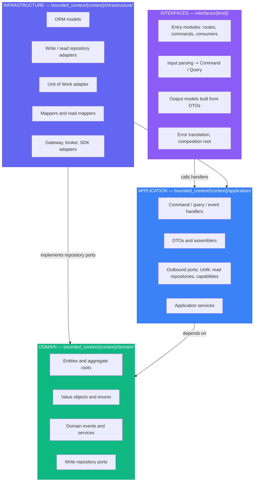
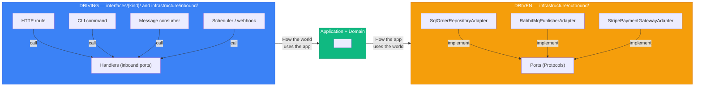

# Quick Reference Cheatsheet (Python)

One-page summary of the decisions this skill makes. It links to the reference that owns
each rule instead of repeating it. Paths use the `ordering` context and the `app` package
root of the [project topology](architecture/project-topology.md). Python language and style
rules (annotations, imports, docstrings, naming spelling) belong to
[`python-syntax`](../../python-syntax/SKILL.md).

## Reference Map

| Need | Read |
| --- | --- |
| Package layout, file and class naming | [Project topology](architecture/project-topology.md) |
| Layer responsibilities, ports and adapters | [Layers](architecture/layers.md), [Hexagonal](architecture/hexagonal.md) |
| Wiring, process resources, a second interface | [Composition root](architecture/composition-root.md) |
| Entities, value objects, aggregates, repositories, UoW | [Tactical patterns](ddd/tactical-patterns.md) |
| Commands, queries, read models, outbox, projections | [CQRS implementation](cqrs/implementation.md), [CQRS events](cqrs/events.md) |
| Context boundaries and integration | [Bounded contexts](ddd/bounded-contexts/overview.md), [shared kernel](ddd/bounded-contexts/shared-kernel.md), [context mapping](ddd/context-mapping.md) |
| Exceptions, codes, translation | [Error model](errors/error-model.md) |
| Interfaces (API, CLI, worker, ...) | [Interface adapter contract](interfaces/adapter-contract.md); delivery code in `ddd-interface-fastapi`, `ddd-interface-cli` |
| Deployment shapes | [Deployment overview](deployment/overview.md): single service, [modular monolith](deployment/modular-monolith.md) ([topology](deployment/modular-monolith-topology.md)), [microservices](deployment/microservices.md) |
| Between modules or services | [Communication](deployment/communication.md), [extraction playbook](deployment/extraction-playbook.md) |
| Tests and architecture checks | [Testing strategy](testing/strategy.md) |
| Specifications, telemetry | [Specification](patterns/specification.md), [observability skeleton](observability/skeleton.md) |

## Layer Summary



| Layer | Owns | Never |
| --- | --- | --- |
| Domain | Invariants, state transitions, events, write repository contracts | Frameworks, I/O, DTOs, application or infrastructure imports |
| Application | One use case per handler, transactions through the UoW port, DTOs | Concrete adapters, SQL, delivery frameworks, returning entities |
| Infrastructure | How a concrete technology is used, as `...Adapter` classes | Business rules, imports of `interfaces/` |
| Interfaces | Translating input to commands/queries and DTOs/errors to output | Business rules, transactions, storage queries, other interfaces |

*Dependencies point inward. One composition root per process chooses the adapters.*

## Quick Decision Trees

### "Where does this code go?"

```text
Is it a business rule, invariant, or state transition?
├── YES → domain/ (aggregate method; domain service if it spans aggregates)
└── NO ↓

Does it orchestrate one use case (load, call the domain, persist, return a DTO)?
├── YES → application/handlers/{commands,queries,events}/
└── NO ↓

Is it only a cast from one type to another, with no decision?
├── YES → mapper/assembler in the layer's mappers/ folder
└── NO ↓

Is it application-specific policy or processing (extraction, redaction, grounding, ranking, strategy or prompt selection)?
├── YES → application/services/<capability>/ (see placement rules in project topology)
└── NO ↓

Is it a contract the application needs from the outside world?
├── YES → application/ports/<capability>/ (aggregate write repository: domain/repositories/)
└── NO ↓

Does it talk to a concrete technology (database, broker, SDK, HTTP client)?
├── YES → infrastructure/{inbound,outbound}/... as a ...Adapter class
└── NO ↓

Does it turn a delivery mechanism (HTTP request, CLI arguments, message) into a
command or query, and a DTO or error back into output?
├── YES → interfaces/<kind>/ (rules from its interface skill)
└── NO ↓

Does it choose concrete adapters and build handlers?
├── YES → composition root: interfaces/<kind>/bootstrap/, or <package>/bootstrap/ once shared
└── NO ↓

Is it typed configuration or environment loading?
├── YES → core/configurations/
└── NO → Reconsider; it is probably domain
```

### "Entity or Value Object?"

```text
Does it have a unique identity that persists while its attributes change?
├── YES → Entity
└── NO ↓

Is it defined entirely by its attributes?
├── YES → Value Object
└── NO → Probably an Entity
```

### "Aggregate boundary?"

```text
Must these objects change together atomically to keep an invariant?
├── YES → Same aggregate
└── NO ↓

Can one exist without the other?
├── YES → Different aggregates (reference by ID, consistency through events)
└── NO → Probably the same aggregate
```

### "Domain Service or Entity method?"

```text
Does it naturally belong to one entity?
├── YES → Entity method
└── NO ↓

Does it need several aggregates, or stateless business logic?
├── YES → Domain service (domain/services/)
└── NO → Reconsider placement; orchestration belongs in a handler
```

### "Command or Query?"

```text
Does it change state?
├── YES → Command: aggregate behaviour + Unit of Work, returns a DTO (or nothing)
└── NO → Query: read repository port, returns DTOs, never touches aggregates
```

### "Which exception base?"

| Failure | Base | Typical hint |
| --- | --- | --- |
| A domain invariant or rule rejected the operation | `DomainException` | 422, 409 |
| The use case cannot proceed (missing resource, wrong state for this use case) | `ApplicationException` | 404, 409 |
| A concrete dependency failed, translated in its adapter | `InfrastructureException` | 500, 503 |
| The interface could not accept the input | `InterfaceException` | 400 |
| Configuration or process policy | `CoreException` | 500 |

Never a built-in (`ValueError`, `Exception`) for an expected failure. See the
[error model](errors/error-model.md).

## Pattern Selection Guide

| Pattern | When to use | Shape | Detail |
| --- | --- | --- | --- |
| Value object | Immutable concept equal by value | `class Money(ValueObject)` | [Tactical](ddd/tactical-patterns.md) |
| Entity | Identity with a lifecycle | `@dataclass(slots=True, kw_only=True, eq=False)` + `create()` | [Tactical](ddd/tactical-patterns.md) |
| Aggregate root | Consistency and transaction boundary | Entity that records domain events | [Tactical](ddd/tactical-patterns.md) |
| Domain event | Something that happened in the domain | `OrderPlacedEvent` | [CQRS events](cqrs/events.md) |
| Command handler | Write use case | `PlaceOrderHandler`: `IHandler[PlaceOrderCommand, OrderDTO]` | [CQRS](cqrs/implementation.md) |
| Query handler | Read use case | `GetOrderHandler` -> `OrderDTO`, or a paginated DTO | [CQRS](cqrs/implementation.md) |
| Unit of Work | Transaction around one aggregate change | `async with self._uow_factory() as uow:` | [Tactical](ddd/tactical-patterns.md) |
| Write repository | Load and save one aggregate type | `IOrderRepository`, works with entities | [Tactical](ddd/tactical-patterns.md) |
| Read repository | Optimized query | `IOrderReadRepository`, returns DTOs | [CQRS](cqrs/implementation.md) |
| Persistence mapper | ORM <-> entity | `OrderMapper.to_orm` / `to_entity` | [Topology](architecture/project-topology.md#naming) |
| Read mapper | ORM -> DTO, skipping the entity | `OrderReadMapper.to_dto` | [CQRS](cqrs/implementation.md) |
| Assembler | Entity/VO -> DTO | `OrderAssembler.to_dto` | [Topology](architecture/project-topology.md#naming) |
| Interface output model | DTO -> HTTP schema, CLI response, message | `Model.model_validate(dto)` | Interface skill |
| Adapter | Any concrete infrastructure class | `SqlOrderRepositoryAdapter` | [Topology](architecture/project-topology.md#ports-and-implementations) |
| Specification | Reusable, combinable business predicate | `OverdueOrderSpecification` | [Specification](patterns/specification.md) |
| Anti-corruption layer | Consuming another context or an external model | Adapter translating into local types | [Context mapping](ddd/context-mapping.md) |

Mapping chain: ORM <-> entity (mapper, infrastructure), entity -> DTO (assembler,
application), ORM -> DTO (read mapper, infrastructure), DTO -> output model (interface).
Every mapper method is `to_<destination>`, never `from_<source>`.

### Handler Shape at a Glance

```python
# app/shared_kernel/application/handlers/i_handler.py
from typing import Protocol


class IHandler[TAction, TResult](Protocol):
    async def handle(self, action: TAction) -> TResult: ...
```

```python
# app/bounded_context/ordering/application/handlers/commands/place_order_handler.py
from collections.abc import Callable
from decimal import Decimal
from uuid import UUID

from app.bounded_context.ordering.application.dtos.order_dto import OrderDTO
from app.bounded_context.ordering.application.mappers.order_assembler import OrderAssembler
from app.bounded_context.ordering.application.ports.transactions import IOrderingUnitOfWork
from app.bounded_context.ordering.domain.entities.order import Order
from app.bounded_context.ordering.domain.value_objects.customer_id import CustomerId
from app.bounded_context.ordering.domain.value_objects.money import Money
from app.bounded_context.ordering.domain.value_objects.product_id import ProductId
from app.utils import FrozenObject


class PlaceOrderLine(FrozenObject):
    product_id: UUID
    quantity: int
    unit_price: Decimal


class PlaceOrderCommand(FrozenObject):  # input contract, lives in the handler's file
    customer_id: UUID
    currency: str
    lines: tuple[PlaceOrderLine, ...]


class PlaceOrderHandler:  # satisfies IHandler[PlaceOrderCommand, OrderDTO]
    def __init__(self, uow_factory: Callable[[], IOrderingUnitOfWork]) -> None:
        self._uow_factory = uow_factory

    async def handle(self, action: PlaceOrderCommand) -> OrderDTO:
        async with self._uow_factory() as uow:
            order = Order.create(
                customer_id=CustomerId(value=action.customer_id), currency=action.currency
            )
            for line in action.lines:
                order.add_item(
                    product_id=ProductId(value=line.product_id),
                    quantity=line.quantity,
                    unit_price=Money(amount=line.unit_price, currency=action.currency),
                )
            order.place()  # the aggregate enforces "not empty", not the handler
            await uow.orders.save(order)
            await uow.commit()
        return OrderAssembler.to_dto(order)  # a DTO, never the entity
```

Full templates: [tactical patterns](ddd/tactical-patterns.md) for the domain,
[CQRS implementation](cqrs/implementation.md) for handlers, ports, read models, and the
Unit of Work, [composition root](architecture/composition-root.md) for wiring. Routers,
dependency factories, schemas, commands, and output rendering belong to
`ddd-interface-fastapi` and `ddd-interface-cli`.

## Port Naming Conventions

| Port | Location | Pattern | Example |
| --- | --- | --- | --- |
| Inbound (driving) | `application/handlers/{commands,queries}/<verb>_<noun>_handler.py` | `<Verb><Noun>Handler`, satisfies `IHandler[TAction, TResult]` | `PlaceOrderHandler` |
| Handler protocol | `shared_kernel/application/handlers/` | `IHandler[TAction, TResult]` | `IHandler[PlaceOrderCommand, OrderDTO]` |
| Write repository | `domain/repositories/i_<aggregate>_repository.py` | `I<Aggregate>Repository` | `IOrderRepository` |
| Read repository | `application/ports/read_repositories/i_<name>_read_repository.py` | `I<Name>ReadRepository` | `IOrderReadRepository` |
| Unit of Work | `application/ports/transactions/i_<context>_unit_of_work.py` | `I<Context>UnitOfWork` | `IOrderingUnitOfWork` |
| Other outbound | `application/ports/<capability>/i_<capability>.py` | `I<Capability>` | `IPaymentGateway`, `IEventPublisher` |
| Runtime provider factory | `application/ports/<capability>/i_<capability>_factory.py` | `I<Capability>Factory` | `ILlmFactory` |
| Process resource | `shared_kernel/application/ports/resources/i_resource.py` | `IResource` | `IResource` |
| Implementation | `infrastructure/{inbound,outbound}/.../<name>_adapter.py` | `<Technology><Name>Adapter` | `SqlOrderRepositoryAdapter`, `StripePaymentGatewayAdapter` |

Ports are prefixed with `I`: `abc.ABC` for repositories, Units of Work, and gateways, `Protocol` for structural technical ports (see [project topology](architecture/project-topology.md#ports-and-implementations)). Implementations end in `Adapter`, never `Impl`,
`Service`, or `Protocol`. Handlers are the inbound ports; there is no
`application/ports/inbound/` package.

## Common Anti-Patterns

| Anti-pattern | Problem | Solution |
| --- | --- | --- |
| Anemic domain | Entities are data bags; rules live in handlers | Move behaviour into aggregates and domain services |
| Fat handler | Business decisions in orchestration code | Handler loads, calls the domain, persists, assembles |
| Handler returns an entity | Interfaces couple to the domain model | Return a DTO through an assembler |
| Interface skips the handler | Route or command calls a repository or adapter | Call handlers received from the composition root |
| Framework in an inner layer | `fastapi`, `typer`, or SQLAlchemy in domain/application | Keep frameworks in `interfaces/<kind>/` and adapters |
| Built-in exception for expected failure | `raise ValueError("not found")` | Typed error with a stable code |
| Rules in a mapper, or a `models/` helper folder | Mapper stops being a cast; helpers hide in `models/` | Cast-only mapper; rules to domain or application services; no `models/` outside persistence |
| Repository per table | Persistence shape drives the model | One write repository per aggregate root |
| God aggregate | Contention and huge transactions | Split by invariant; reference by ID |
| Cross-aggregate transaction | Several aggregates in one commit | One aggregate per transaction; events for the rest |
| Cross-context import | Context imports another's entities or repositories | ID, application contract, integration event, or ACL |
| Mixing read and write | Queries rebuild aggregates | Read repository returning DTOs |
| Mutable value object | Shared state changes under you | `FrozenObject` |
| `...Service` in infrastructure | Hides that it is a concrete adapter | `...Adapter` suffix |
| Patching in tests | `mock.patch("app....")` couples tests to import paths | Fakes implementing ports, injected through constructors |
| Speculative structure | Empty `bootstrap/`, `adapters/`, or `ports/inbound/` packages | Create a package only for a present responsibility |
| Hidden shared state | Modules exchange objects through string keys on framework state | Typed public bootstrap return values or event-fed projections |

## Dependency Rules Matrix

Rows import columns.

| Importer \ Imported | domain | application | infrastructure | `interfaces/<kind>` | Delivery framework |
| --- | --- | --- | --- | --- | --- |
| **domain** | ✅ | ❌ | ❌ | ❌ | ❌ |
| **application** | ✅ | ✅ | ❌ | ❌ | ❌ |
| **infrastructure** | ✅ | ✅ | ✅ | ❌ | ❌ |
| **interfaces/<kind>** | through application contracts | ✅ | only in its own bootstrap | ❌ other kinds | ✅ |
| **`<package>/bootstrap/`** | ✅ | ✅ | ✅ | ❌ | ❌ |
| **core/, exceptions/** | ❌ | ❌ | ❌ | ❌ | ❌ |

- A context never imports another context's `domain`, `application`, or
  `infrastructure`; see [bounded contexts](ddd/bounded-contexts/overview.md).
- Every layer may import `exceptions/` bases and `utils/` (`FrozenObject`); the domain
  imports only the pure domain subset of errors.
- Broker or SDK clients used by adapters are not delivery frameworks. Enforce the matrix
  with the import contracts and `scripts/ddd-check.py` described in
  [testing strategy](testing/strategy.md#architecture-tests).

## Hexagonal Quick Reference



## When to Use / Skip

### Use DDD + Hexagonal + CQRS When

- ✅ The business domain has many rules and invariants
- ✅ The system lives for years
- ✅ Several people or teams work on it
- ✅ Infrastructure must be swappable (database, broker, provider)
- ✅ Several entry points share the same use cases (API, CLI, worker, scheduled jobs)
- ✅ High test coverage is required without slow suites

### Skip When

- ❌ Simple CRUD with little behaviour
- ❌ Prototype, MVP, or throwaway code
- ❌ One or two developers on a short-lived project
- ❌ Trivial business logic

### Complexity Ladder (Start Simple)

```text
Level 1: Simple layered (entry point → service → repository)
   ↓ when business rules grow complex
Level 2: Domain model (entities and aggregates with behaviour)
   ↓ when several entry points or swappable infrastructure appear
Level 3: Hexagonal (ports and adapters, one composition root)
   ↓ when read and write needs diverge
Level 4: CQRS (handlers, read repositories returning DTOs)
   ↓ when a complete audit trail or temporal queries are required
Level 5: Event sourcing (store events, derive state)
```

Do not skip levels. Move up only when the current level has proven insufficient. The
deployment shape (single service, modular monolith, microservices) is a separate axis;
see the [deployment overview](deployment/overview.md).

## Dataclass and Pydantic Configuration Guide

| Kind | Base | Why |
| --- | --- | --- |
| Value object | `ValueObject` (shared kernel), built on `FrozenObject` (pydantic, `frozen=True`, `from_attributes=True`) | Immutable, validated, equal by value, hashable |
| Entity / aggregate root | `Entity` / `AggregateRoot` with `@dataclass(slots=True, kw_only=True, eq=False)` and a `create()` classmethod | Mutable state behind methods, identity equality, explicit construction, no framework |
| Enum | `enum.StrEnum` (or `Enum`) named `...Enum` | Closed set of domain values |
| Domain event | Frozen pydantic model (`DomainEvent`) | Immutable fact; see [CQRS events](cqrs/events.md) |
| Command / query | `FrozenObject`, defined in its handler's file | Immutable input contract |
| DTO | `FrozenObject` in `application/dtos/` | Immutable output contract; interfaces call `Model.model_validate(dto)` |
| Settings | `pydantic_settings.BaseSettings` in `core/configurations/` | Configuration boundary, never in the domain |

```python
# app/utils/__init__.py
from pydantic import BaseModel, ConfigDict


class FrozenObject(BaseModel):
    model_config = ConfigDict(frozen=True, from_attributes=True)
```

```python
# app/bounded_context/ordering/domain/value_objects/money.py
from decimal import Decimal
from typing import Self

from app.exceptions.ordering_errors import CurrencyMismatchError
from app.shared_kernel.domain.value_objects import ValueObject


class Money(ValueObject):
    amount: Decimal
    currency: str

    def add(self, other: Self) -> Self:
        if other.currency != self.currency:
            raise CurrencyMismatchError(self.currency, other.currency)
        return self.model_copy(update={"amount": self.amount + other.amount})
```

```python
# app/bounded_context/ordering/domain/entities/order.py
from dataclasses import dataclass
from typing import Self

from app.bounded_context.ordering.domain.enums.order_status_enum import OrderStatusEnum
from app.bounded_context.ordering.domain.value_objects.customer_id import CustomerId
from app.bounded_context.ordering.domain.value_objects.order_id import OrderId
from app.shared_kernel.domain.entities import AggregateRoot


@dataclass(slots=True, kw_only=True, eq=False)
class Order(AggregateRoot[OrderId]):
    customer_id: CustomerId
    currency: str = "EUR"
    status: OrderStatusEnum = OrderStatusEnum.DRAFT

    @classmethod
    def create(cls, *, customer_id: CustomerId, currency: str = "EUR") -> Self:
        return cls(id=OrderId(), customer_id=customer_id, currency=currency)
```

```python
# app/bounded_context/ordering/application/dtos/order_dto.py
from datetime import datetime
from decimal import Decimal
from uuid import UUID

from app.utils import FrozenObject


class OrderDTO(FrozenObject):
    id: UUID
    customer_id: UUID
    status: str
    currency: str
    total_amount: Decimal
    created_at: datetime
    updated_at: datetime
```

Use `Decimal` for money, never `float`. Behaviour, invariants, and domain events of the
aggregate are in [tactical patterns](ddd/tactical-patterns.md). Import grouping and
ordering are defined by `python-syntax`
([import conventions](../../python-syntax/SKILL.md#5-import-conventions)).

## Resources

- *Domain-Driven Design*, Eric Evans (2003)
- *Implementing Domain-Driven Design*, Vaughn Vernon (2013)
- *Clean Architecture*, Robert C. Martin (2017)
- *Architecture Patterns with Python* (Cosmic Python), Percival & Gregory (2020): <https://www.cosmicpython.com/>
- [Hexagonal Architecture](https://alistair.cockburn.us/hexagonal-architecture/), Alistair Cockburn

## Review Checklist

- [ ] Each piece of code sits where the "Where does this code go?" tree puts it; delivery code is only in `interfaces/<kind>/`.
- [ ] Paths and names follow the [project topology](architecture/project-topology.md) naming table: `I...` ports, `...Adapter` implementations, `...Enum` enums, `...DTO` DTOs, `to_<destination>` mappers.
- [ ] Value objects (via `ValueObject`), commands, queries, and DTOs are `FrozenObject`s; entities are `@dataclass(slots=True, kw_only=True, eq=False)` subclasses of `Entity`/`AggregateRoot` with `create()`.
- [ ] Handlers satisfy `IHandler`, use the Unit of Work for writes, and return DTOs, never entities.
- [ ] The dependency matrix holds and is enforced by import contracts and `scripts/ddd-check.py`.
- [ ] Expected failures raise typed errors from the right category base.
- [ ] Interfaces follow the [adapter contract](interfaces/adapter-contract.md); the deployment shape follows the [deployment overview](deployment/overview.md).
- [ ] The complexity level is justified; no level was skipped and no empty structure was created.
