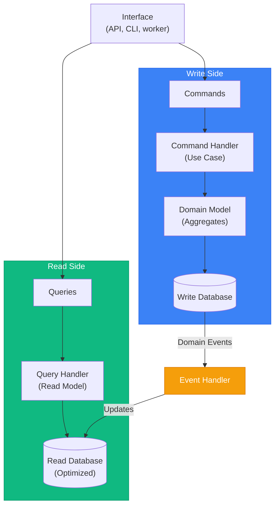

# CQRS & Domain Events

> Sources:
> - [CQRS](https://martinfowler.com/bliki/CQRS.html) — Martin Fowler
> - [Event Sourcing](https://martinfowler.com/eaaDev/EventSourcing.html) — Martin Fowler
> - [CQRS Pattern](https://learn.microsoft.com/en-us/azure/architecture/patterns/cqrs) — Microsoft Azure
> - [Transactional Outbox](https://microservices.io/patterns/data/transactional-outbox.html) — microservices.io
> - [Domain Events – Salvation](https://udidahan.com/2009/06/14/domain-events-salvation/) — Udi Dahan
> - [Strengthening Your Domain: Domain Events](https://lostechies.com/jimmybogard/2010/04/08/strengthening-your-domain-domain-events/) — Jimmy Bogard
> - [Domain Events: Design and Implementation](https://learn.microsoft.com/en-us/dotnet/architecture/microservices/microservice-ddd-cqrs-patterns/domain-events-design-implementation) — Microsoft

Examples use the context `ordering`, the aggregate `Order`, and the package root `app`,
in the single-service layout of the [project topology](../architecture/project-topology.md).
In a modular monolith the same paths sit below `modules/<module>/`; see the
[modular monolith topology](../deployment/modular-monolith-topology.md). Commands,
queries, handlers, the Unit of Work, and read repositories are implemented in
[CQRS implementation](implementation.md); the aggregate and its events in
[tactical patterns](../ddd/tactical-patterns.md).

## CQRS Overview

**Command Query Responsibility Segregation** separates read and write operations into
different models.



---

## Commands vs Queries

| | Command (write side) | Query (read side) |
| --- | --- | --- |
| Intent | Change state: "place this order" | Read state: "show me this order" |
| Input | `PlaceOrderCommand` (`FrozenObject`) in `handlers/commands/place_order_handler.py` | `GetOrderQuery` (`FrozenObject`) in `handlers/queries/get_order_handler.py` |
| Goes through | Aggregate + Unit of Work (`IOrderingUnitOfWork`) | Read repository port (`IOrderReadRepository`) |
| Returns | A DTO, an ID, or nothing | DTOs (`OrderDTO`, `OrderPageDTO`) |
| Side effects | Yes, and the aggregate may record domain events | None |

Callers (a REST API, a CLI, a worker) are interchangeable: each receives handlers from the
[composition root](../architecture/composition-root.md). Code for both sides is in
[CQRS implementation](implementation.md).

---

## When to Use CQRS

> **Warning:** "You should be very cautious about using CQRS... the majority of cases I've run into have not been so good." — Martin Fowler

CQRS adds significant complexity. Most applications don't need it.

### Use CQRS When:

- Read and write workloads have **dramatically** different scaling requirements
- Complex queries that genuinely don't map well to domain model
- Different teams work on read vs write sides
- Event sourcing is used (CQRS pairs naturally with ES)
- You've proven simpler approaches are insufficient

### Skip CQRS When:

- Simple CRUD application (most applications)
- Read/write patterns are similar
- Small team, simple domain
- You haven't tried a simple reporting database first
- Adding it "just in case"

**CQRS applies to specific bounded contexts, never entire systems.**

### Simplified CQRS (Start Here)

Start simple: same database, different query paths. Use **separate handlers** for commands
(`PlaceOrderHandler` through the aggregate and Unit of Work) and queries
(`ListOrdersHandler` through a read repository that maps rows straight to DTOs), injected
directly by the composition root. No bus is needed. See
[CQRS implementation](implementation.md).

Evolve to a separate read store, fed by events, only when needed.

---

## Read Model (Projection)

An optimized structure for queries. It can denormalize data (for example, store the
order total and item count on one summary row) so reads need no joins across aggregates
or contexts. Read repositories return **DTOs directly**; their port and SQLAlchemy adapter
are in [CQRS implementation](implementation.md#read-repository-port).

- **Same tables, different query paths** is the default: the read adapter queries the
  write tables and maps rows to DTOs.
- **A dedicated projection** (a summary table, a search index, a separate database) is fed
  by [event handlers](#event-handlers). It is eventually consistent with the write side.
- Query filters stay on the Query and are translated into SQL by the read adapter. They are
  not domain Specifications.

**Note:** Separate write and read databases are optional: write is normalized for
transactions, read is denormalized for queries.

---

## Domain Events

Notifications that something happened in the domain. Used for:

- Updating read models
- Cross-aggregate communication
- Integration with other bounded contexts (after mapping to an integration event)

### Event Structure

A domain event is an immutable `FrozenObject` named for a fact in the past tense
(`<Fact>Event`), one per file in `domain/events/<fact>_event.py`. It extends the shared
`DomainEvent` base (`app/shared_kernel/domain/events/`), which supplies `event_id: UUID`
and `occurred_at: datetime`. Because it never leaves the context, it may carry the
context's value objects:

```python
# app/bounded_context/ordering/domain/events/order_placed_event.py
from app.bounded_context.ordering.domain.value_objects import CustomerId, Money, OrderId
from app.shared_kernel.domain.events import DomainEvent


class OrderPlacedEvent(DomainEvent):
    order_id: OrderId
    customer_id: CustomerId
    total: Money
```

The base class, the `AggregateRoot` that records events, and the full `Order` aggregate are
in [tactical patterns](../ddd/tactical-patterns.md#domain-event). Money is `Money` with a
`Decimal` amount, never `float`.

### Raising Events

The aggregate records events while it changes; it never publishes them. `Order.place()`
records `OrderPlacedEvent` through `AggregateRoot._record`, and the application takes them
with `order.pull_domain_events()`, which returns and clears the pending list, after the change is
persisted.

### Dispatching Events

Publish only facts that were committed. The command handler pulls the events after
`commit()` and hands them to the injected `IEventPublisher`, the bus port defined in
[communication](../deployment/communication.md#bus-ports).

```python
# app/bounded_context/ordering/application/handlers/commands/place_order_handler.py (in-process dispatch, excerpt)
class PlaceOrderHandler(IHandler[PlaceOrderCommand, OrderDTO]):
    def __init__(
        self,
        uow_factory: Callable[[], IOrderingUnitOfWork],
        publisher: IEventPublisher,
    ) -> None:
        self._uow_factory = uow_factory
        self._publisher = publisher

    async def handle(self, action: PlaceOrderCommand) -> OrderDTO:
        async with self._uow_factory() as uow:
            order = Order.create(
                customer_id=CustomerId(value=action.customer_id),
                currency=action.currency,
            )
            for line in action.lines:
                order.add_item(
                    product_id=ProductId(value=line.product_id),
                    quantity=line.quantity,
                    unit_price=Money(amount=line.unit_price, currency=action.currency),
                )
            order.place()
            await uow.orders.save(order)
            await uow.commit()

        for event in order.pull_domain_events():  # after commit: never publish an uncommitted fact
            await self._publisher.publish(event)
        return OrderAssembler.to_dto(order)
```

This is delivery **level 0**: if the process dies between commit and publish, the event is
lost. Use it for in-context reactions that can be rebuilt (projections). Anything another
context, module, or service relies on goes through the [outbox](#outbox-pattern).

### Event Handlers

Event handlers live in `application/handlers/events/<fact>_handler.py`. They react to a
fact through outbound ports; they never import an ORM model or a session. When the
reaction requires a business decision, the handler translates the event into a local
command and dispatches it to a command handler, as the consumer ACL in
[communication](../deployment/communication.md#consumer-as-acl) does.

**Projection handler** (updates the read model):

```python
# app/bounded_context/ordering/application/ports/projections/i_order_projection.py
from typing import Protocol

from app.bounded_context.ordering.domain.events.order_placed_event import OrderPlacedEvent


class IOrderProjection(Protocol):
    """Keeps the order read model in step with the write side."""

    async def apply_placed(self, event: OrderPlacedEvent) -> None: ...
```

```python
# app/bounded_context/ordering/application/handlers/events/order_placed_handler.py
from app.bounded_context.ordering.application.ports.projections import IOrderProjection
from app.bounded_context.ordering.domain.events.order_placed_event import OrderPlacedEvent


class OrderPlacedHandler:
    """Projects OrderPlacedEvent into the order summary read model."""

    def __init__(self, projection: IOrderProjection) -> None:
        self._projection = projection

    async def handle(self, event: OrderPlacedEvent) -> None:
        await self._projection.apply_placed(event)
```

The composition root subscribes it:
`subscriber.subscribe(OrderPlacedEvent, order_placed_handler.handle)`.

```python
# app/bounded_context/ordering/infrastructure/outbound/persistence/projections/sql_order_projection_adapter.py
from sqlalchemy.dialects.postgresql import insert
from sqlalchemy.exc import SQLAlchemyError
from sqlalchemy.ext.asyncio import AsyncSession, async_sessionmaker

from app.bounded_context.ordering.domain.enums.order_status_enum import OrderStatusEnum
from app.bounded_context.ordering.domain.events.order_placed_event import OrderPlacedEvent
from app.bounded_context.ordering.infrastructure.outbound.persistence.models.order_summary_model import (
    OrderSummaryModel,
)
from app.exceptions.ordering_errors import OrderingPersistenceError


class SqlOrderProjectionAdapter:
    """SQLAlchemy implementation of IOrderProjection; every write is naturally idempotent."""

    def __init__(self, session_factory: async_sessionmaker[AsyncSession]) -> None:
        self._session_factory = session_factory

    async def apply_placed(self, event: OrderPlacedEvent) -> None:
        statement = (
            insert(OrderSummaryModel)
            .values(
                order_id=event.order_id.value,
                customer_id=event.customer_id.value,
                status=OrderStatusEnum.PLACED.value,
                total=event.total.amount,
                currency=event.total.currency,
                placed_at=event.occurred_at,
            )
            .on_conflict_do_nothing(index_elements=[OrderSummaryModel.order_id])
        )
        try:
            async with self._session_factory() as session, session.begin():
                await session.execute(statement)
        except SQLAlchemyError as error:
            raise OrderingPersistenceError("project") from error
```

`OrderSummaryModel` extends the context's `OrderingBase`. Later facts update the row with a
conditional `UPDATE ... WHERE status = <expected>`, so a replayed event changes nothing.
If the projection lives in the same database and must never lag, update it inside the
command's Unit of Work instead of from an event handler.

**Side-effect handlers** (send a confirmation, call another system) follow the same shape
through their own outbound port, for example `IOrderNotifier` in
`application/ports/notifications/i_order_notifier.py` implemented by
`SmtpOrderNotifierAdapter` in `infrastructure/outbound/notifications/`. Several reactions
to one fact are separate handlers subscribed to the same event, named for their reaction
(`notify_order_placed_handler.py`), so one failure never blocks another. The event carries
what the reaction needs, so a handler does not reload the aggregate.

---

## Domain Events vs Integration Events

| | Domain event | Integration event |
| --- | --- | --- |
| Audience | The owning bounded context | Other contexts, modules, or services |
| Granularity | Fine-grained, low-level (`OrderItemQuantityIncreasedEvent`) | Coarser-grained (the `OrderPlacedEvent` contract) |
| Purpose | Trigger internal processes and projections | Notify other units; feed their projections |
| Types | Domain language; value objects, `Decimal`, `datetime` | JSON-native only; no `float` money; no entity, value object, or domain enum |
| Lives in | `domain/events/<fact>_event.py` | The publisher's contracts package |
| Change | Changes freely with the model | Versioned with `schema_version`; a published version never changes |
| Delivered by | In-process dispatch or the outbox | The outbox, then a bus or broker |

The integration event's **contract shape** (a `FrozenObject` from `app.utils` carrying
`event_id`, `occurred_at`, `schema_version`, string IDs and ISO-8601 datetimes, money as a
decimal string plus currency), the bus ports, and the consumer ACL are defined once in
[communication](../deployment/communication.md#contract-shape). Do not redefine them here.
In a modular monolith the contract lives in `modules/<module>/contracts/`; between
services it is published as a versioned artifact (see
[microservices](../deployment/microservices.md)).

### Mapping a Domain Event to a Contract

The publishing context maps the domain events that leave it to contracts. Internal facts
map to nothing. The example is in a modular monolith, where the contract package is
`modules/ordering/contracts/`.

```python
# app/modules/ordering/bounded_context/ordering/application/mappers/order_contract_mapper.py
from app.modules.ordering.bounded_context.ordering.domain.events.order_placed_event import (
    OrderPlacedEvent,
)
from app.modules.ordering.contracts.order_placed_event import (
    OrderPlacedEvent as OrderPlacedContract,
)
from app.shared_kernel.application.ports.outbox import IIntegrationEvent
from app.shared_kernel.domain.events import DomainEvent


class OrderContractMapper:
    """Maps the ordering context's published facts to their contracts."""

    @staticmethod
    def to_contract(event: DomainEvent) -> IIntegrationEvent | None:
        match event:
            case OrderPlacedEvent():
                return OrderPlacedContract(
                    event_id=str(event.event_id),
                    occurred_at=event.occurred_at.isoformat(),
                    order_id=str(event.order_id.value),
                    customer_id=str(event.customer_id.value),
                    total_amount=str(event.total.amount),
                    currency=event.total.currency,
                )
            case _:
                return None  # internal fact, not part of the published language
```

The domain event and its contract share a name in different packages; alias the import so
the two are never confused. Reusing the domain event's `event_id` keeps one identity per
fact across retries.

---

## Outbox Pattern

Writes each integration event in the **same transaction** as the state change, then a
relay publishes it. Delivery is **at-least-once**: a crash after publishing and before
marking the row republishes it, so every consumer must be
[idempotent](#idempotent-consumer-pattern).

### Outbox Port

The port is a shared technical contract in the shared kernel:

```python
# app/shared_kernel/application/ports/outbox/i_outbox.py
from typing import Protocol


class IIntegrationEvent(Protocol):
    """Structural shape of every published contract."""

    @property
    def event_id(self) -> str: ...

    @property
    def occurred_at(self) -> str: ...

    @property
    def schema_version(self) -> int: ...

    def model_dump_json(self) -> str: ...


class IOutbox(Protocol):
    """Stores contracts in the current transaction for later publication."""

    async def add(self, event: IIntegrationEvent) -> None: ...
```

The context's Unit of Work exposes it, so it shares the transaction:

```python
# app/bounded_context/ordering/application/ports/transactions/i_ordering_unit_of_work.py (excerpt)
class IOrderingUnitOfWork(abc.ABC):
    orders: IOrderRepository
    outbox: IOutbox
    # __aenter__, __aexit__, commit, rollback as in implementation.md
```

### Outbox Adapter

The outbox table belongs to the publishing context, so it uses the context's declarative
base and migrates and moves with it. Keep the adapter, model, and relay in
`.../infrastructure/outbound/persistence/outbox/`. A shared implementation in
`app/shared_kernel/infrastructure/outbox/` is possible when every context uses one schema;
it then needs its own declarative base.

```python
# app/bounded_context/ordering/infrastructure/outbound/persistence/outbox/sql_outbox_adapter.py
from sqlalchemy.ext.asyncio import AsyncSession

from app.bounded_context.ordering.infrastructure.outbound.persistence.outbox.outbox_message_model import (
    OutboxMessageModel,
)
from app.shared_kernel.application.ports.outbox import IIntegrationEvent


class SqlOutboxAdapter:
    """SQLAlchemy implementation of IOutbox on the Unit of Work's session."""

    def __init__(self, session: AsyncSession) -> None:
        self._session = session

    async def add(self, event: IIntegrationEvent) -> None:
        self._session.add(
            OutboxMessageModel(
                event_id=event.event_id,
                event_type=f"{type(event).__name__}.v{event.schema_version}",
                occurred_at=event.occurred_at,
                payload=event.model_dump_json(),
            )
        )
```

`SqlOrderingUnitOfWorkAdapter.__aenter__` adds `self.outbox = SqlOutboxAdapter(self._session)`
next to `self.orders`. `OutboxMessageModel` (`outbox_message_model.py`) extends
`OrderingBase` with `event_id` (primary key), `event_type`, `occurred_at`, `payload`,
`created_at`, and a nullable `published_at`.

### Publishing Through the Outbox

```python
# app/bounded_context/ordering/application/handlers/commands/place_order_handler.py (outbox variant, excerpt)
    async def handle(self, action: PlaceOrderCommand) -> OrderDTO:
        async with self._uow_factory() as uow:
            order = Order.create(
                customer_id=CustomerId(value=action.customer_id),
                currency=action.currency,
            )
            for line in action.lines:
                order.add_item(
                    product_id=ProductId(value=line.product_id),
                    quantity=line.quantity,
                    unit_price=Money(amount=line.unit_price, currency=action.currency),
                )
            order.place()
            await uow.orders.save(order)
            for event in order.pull_domain_events():
                if (contract := OrderContractMapper.to_contract(event)) is not None:
                    await uow.outbox.add(contract)
            await uow.commit()  # the order and its outbox rows commit together

        return OrderAssembler.to_dto(order)
```

The handler no longer needs the publisher for integration events. If in-context handlers
(projections) also need the events, keep a copy of the pulled list and dispatch it
in-process after the commit.

### Relay

The relay is a [process resource](../architecture/composition-root.md#process-resources):
it implements `IResource` and owns a polling task. The process that runs it is an
interface decision: a dedicated worker, the API process's startup and shutdown, or a
scheduled CLI command that calls `relay_once()`.

```python
# app/shared_kernel/application/ports/messaging/i_message_publisher.py
from typing import Protocol


class IMessagePublisher(Protocol):
    """Sends an already serialized message to the broker."""

    async def publish(self, *, topic: str, message_id: str, payload: str) -> None: ...
```

```python
# app/bounded_context/ordering/infrastructure/outbound/persistence/outbox/outbox_relay_adapter.py
import asyncio
import contextlib
import logging
from datetime import UTC, datetime

from sqlalchemy import select
from sqlalchemy.ext.asyncio import AsyncSession, async_sessionmaker

from app.bounded_context.ordering.infrastructure.outbound.persistence.outbox.outbox_message_model import (
    OutboxMessageModel,
)
from app.shared_kernel.application.ports.messaging import IMessagePublisher

logger = logging.getLogger(__name__)


class OutboxRelayAdapter:
    """Process resource that publishes committed outbox rows to the broker."""

    def __init__(
        self,
        session_factory: async_sessionmaker[AsyncSession],
        publisher: IMessagePublisher,
        *,
        batch_size: int = 100,
        idle_seconds: float = 1.0,
    ) -> None:
        self._session_factory = session_factory
        self._publisher = publisher
        self._batch_size = batch_size
        self._idle_seconds = idle_seconds
        self._task: asyncio.Task[None] | None = None

    async def startup(self) -> None:
        self._task = asyncio.create_task(self._run(), name="ordering-outbox-relay")

    async def shutdown(self) -> None:
        if self._task is None:
            return
        self._task.cancel()
        with contextlib.suppress(asyncio.CancelledError):
            await self._task
        self._task = None

    async def relay_once(self) -> int:
        """Publish one batch of pending rows and return how many were published."""
        async with self._session_factory() as session, session.begin():
            rows = (
                await session.scalars(
                    select(OutboxMessageModel)
                    .where(OutboxMessageModel.published_at.is_(None))
                    .order_by(OutboxMessageModel.created_at)
                    .limit(self._batch_size)
                    .with_for_update(skip_locked=True)  # several relays never share a row
                )
            ).all()
            for row in rows:
                await self._publisher.publish(
                    topic=row.event_type, message_id=row.event_id, payload=row.payload
                )
                row.published_at = datetime.now(UTC)
        return len(rows)

    async def _run(self) -> None:
        while True:
            try:
                published = await self.relay_once()
            except Exception:  # last resort: keep relaying; the failed batch is retried
                logger.exception("Outbox relay batch failed")
                published = 0
            if published < self._batch_size:
                await asyncio.sleep(self._idle_seconds)
```

`RabbitMqPublisherAdapter` or `KafkaPublisherAdapter` implements `IMessagePublisher` and
translates broker errors into `InfrastructureException` subclasses. In a modular monolith,
an outbox is required before any broker adapter replaces the in-memory bus (see
[delivery guarantees](../deployment/communication.md#delivery-guarantees)).

---

## Idempotent Consumer Pattern

**Required for reliable event processing.** Messages may be delivered more than once.

The deduplication record must commit in the **same transaction** as the effect. The
consumer ACL (an event handler such as billing's `OrderPlacedHandler` in
[communication](../deployment/communication.md#consumer-as-acl)) passes the contract's
`event_id` as the command's idempotency key, and the command handler records it through
its Unit of Work.

```python
# app/shared_kernel/application/ports/inbox/i_inbox.py
from typing import Protocol


class IInbox(Protocol):
    """Remembers which messages a context has already applied."""

    async def contains(self, message_id: str) -> bool: ...

    async def add(self, message_id: str) -> None: ...
```

```python
# app/bounded_context/billing/application/handlers/commands/charge_payment_handler.py
from collections.abc import Callable

from app.bounded_context.billing.application.ports.transactions import IBillingUnitOfWork
from app.bounded_context.billing.domain.entities.payment import Payment
from app.bounded_context.billing.domain.value_objects import Money
from app.shared_kernel.application.handlers import IHandler
from app.utils import FrozenObject


class ChargePaymentCommand(FrozenObject):
    external_order_id: str
    amount: Money
    idempotency_key: str


class ChargePaymentHandler(IHandler[ChargePaymentCommand, None]):
    def __init__(self, uow_factory: Callable[[], IBillingUnitOfWork]) -> None:
        self._uow_factory = uow_factory

    async def handle(self, action: ChargePaymentCommand) -> None:
        async with self._uow_factory() as uow:
            if await uow.inbox.contains(action.idempotency_key):
                return  # already applied: acknowledge without repeating the effect

            payment = Payment.charge(
                external_order_id=action.external_order_id,
                amount=action.amount,
            )
            await uow.payments.save(payment)
            await uow.inbox.add(action.idempotency_key)
            await uow.commit()  # the effect and the dedupe record commit together
```

`IBillingUnitOfWork` exposes `payments: IPaymentRepository` and `inbox: IInbox`.
`SqlInboxAdapter` in
`app/bounded_context/billing/infrastructure/outbound/persistence/inbox/sql_inbox_adapter.py`
stores `message_id` as a primary key on billing's own declarative base. The `contains`
check is a fast path; the key is the real guard. If two deliveries race, one commit fails,
the Unit of Work adapter raises a typed `InfrastructureException`, the worker retries, and
the retry sees the row and acknowledges.

**Implementation options:**

- Store processed message IDs in the database, in the effect's transaction (recommended)
- Use the message broker's deduplication features
- Design handlers to be naturally idempotent (upserts, conditional updates, as in
  `SqlOrderProjectionAdapter`)

---

## Saga Pattern (Cross-Aggregate Workflows)

For workflows spanning multiple aggregates, use sagas instead of trying to coordinate via
raw domain events.

```text
Saga: PlaceOrderSaga
├── Step 1: Reserve inventory (Inventory aggregate)
├── Step 2: Process payment (Payment aggregate)
├── Step 3: Confirm order (Order aggregate)
└── Compensating actions if any step fails
```

**Saga types:**

- **Choreography:** Each context listens to and publishes events (simpler, harder to trace)
- **Orchestration:** A central coordinator (process manager) manages steps (explicit,
  easier to debug)

A process manager is application code: its event handlers in `handlers/events/` advance a
persisted saga state (an aggregate with its own repository) and dispatch the next command;
each compensation is another command. It never uses a distributed transaction. Between
modules or services, every step travels as an integration event through the outbox; see
the [deployment overview](../deployment/overview.md#communication-patterns).

---

## Event Sourcing: Critical Considerations

> **Warning:** "Extremely difficult to add Event Sourcing to systems not originally designed for it." — Martin Fowler

### When Event Sourcing Makes Sense

- Complete audit trail is a business requirement
- Need to reconstruct state at any point in time
- Domain is inherently event-driven (financial transactions, workflows)
- Debugging requires understanding "how did we get here?"

### When to Avoid Event Sourcing

- Simple CRUD with no audit requirements
- Team unfamiliar with event-driven patterns
- Adding it retroactively to existing system
- No clear business need for temporal queries

### Event Sourcing Requirements

1. **Events must store deltas** — Not final state, but what changed (enables reversal)
2. **Snapshots for performance** — Rebuild from snapshots, not from event 0
3. **External system handling:**
   - Disable notifications during replays
   - Cache external query results with timestamps
4. **Schema evolution strategy** — Events are forever; plan for versioning

---

## Review Checklist

- [ ] CQRS is applied per bounded context and justified; simple contexts use plain handlers on one store.
- [ ] Domain events are immutable `FrozenObject`s named `<Fact>Event` in `domain/events/<fact>_event.py`; money is `Decimal`-based, never `float`.
- [ ] Aggregates record events; the application pulls them with `pull_domain_events()` and publishes only after commit.
- [ ] Event handlers live in `application/handlers/events/`, use outbound ports only (no ORM model or session), and delegate business decisions to a local command.
- [ ] Integration events follow the [contract shape](../deployment/communication.md#contract-shape) and are mapped from domain events by the publisher; no domain type leaks into a contract.
- [ ] Anything another context, module, or service relies on is written to the outbox in the same transaction as the state change.
- [ ] The outbox relay is a process resource (`IResource`) with clean shutdown; delivery is treated as at-least-once.
- [ ] Consumers are idempotent: the dedupe record commits with the effect, keyed on `event_id`.
- [ ] Cross-aggregate workflows use a saga with explicit compensations, never a distributed transaction.
- [ ] Every concrete infrastructure class (`SqlOrderProjectionAdapter`, `SqlOutboxAdapter`, `OutboxRelayAdapter`, `SqlInboxAdapter`) ends in `Adapter`; enums end in `Enum`.
- [ ] Expected failures raise typed project errors, never `ValueError`; adapters translate driver errors with `raise ... from error`.
