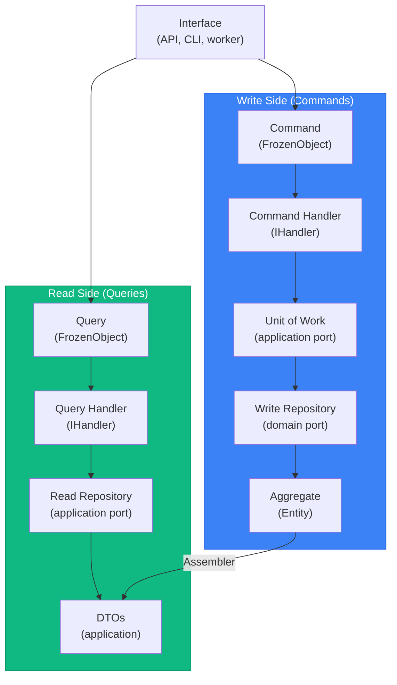

# CQRS Implementation Reference

Pragmatic CQRS: commands and queries are handled by plain handler classes whose ports
are injected by the [composition root](../architecture/composition-root.md). There is
no command bus and no query bus. A REST API, a CLI, and a worker call the same handlers
in the same way.

Read [CQRS & domain events](events.md#when-to-use-cqrs) first to decide whether a context
needs CQRS at all.

## When to Use This Reference

- Separating read and write concerns for clarity
- Optimizing read queries independently from writes
- Different read/write scalability requirements
- Complex queries that don't map well to domain models
- Need to denormalize data for query performance

## Python Conventions

[`python-syntax`](../../../python-syntax/SKILL.md) owns all Python language and
documentation rules. This reference owns only the CQRS decisions: Commands and Queries
are immutable input models (`FrozenObject` from `app.utils`), handlers coordinate
application work, and handlers return DTOs, an ID, or nothing.

Examples use the context `ordering`, the aggregate `Order`, and the package root `app`.
The domain model they call (`Order.create`, `add_item`, `place`, `pull_domain_events`) is defined
in [tactical patterns](../ddd/tactical-patterns.md).

## Core Concepts

### CQRS Separation

Commands mutate state through aggregates and a Unit of Work. Queries retrieve data through
read repositories that return DTOs.



### Where the Pieces Live

The canonical tree and naming table are in the
[project topology](../architecture/project-topology.md). The CQRS-specific elements:

| Element | Path (below `app/`) | Class |
| --- | --- | --- |
| Handler protocol | `shared_kernel/application/handlers/i_handler.py` | `IHandler` |
| Command + handler | `bounded_context/ordering/application/handlers/commands/place_order_handler.py` | `PlaceOrderCommand`, `PlaceOrderHandler` |
| Query + handler | `bounded_context/ordering/application/handlers/queries/get_order_handler.py` | `GetOrderQuery`, `GetOrderHandler` |
| DTOs | `bounded_context/ordering/application/dtos/order_dto.py` | `OrderDTO`, `OrderPageDTO` |
| Assembler (Entity -> DTO) | `bounded_context/ordering/application/mappers/order_assembler.py` | `OrderAssembler` |
| Unit of Work port | `bounded_context/ordering/application/ports/transactions/i_ordering_unit_of_work.py` | `IOrderingUnitOfWork` |
| Read repository port | `bounded_context/ordering/application/ports/read_repositories/i_order_read_repository.py` | `IOrderReadRepository` |
| Write repository port | `bounded_context/ordering/domain/repositories/i_order_repository.py` | `IOrderRepository` |
| Unit of Work adapter | `bounded_context/ordering/infrastructure/outbound/persistence/ordering_unit_of_work_adapter.py` | `SqlOrderingUnitOfWorkAdapter` |
| Write repository adapter | `.../outbound/persistence/repositories/sql_order_repository_adapter.py` | `SqlOrderRepositoryAdapter` |
| Read repository adapter | `.../outbound/persistence/repositories/sql_order_read_repository_adapter.py` | `SqlOrderReadRepositoryAdapter` |
| Read mapper (ORM -> DTO) | `.../outbound/persistence/mappers/read_mappers/order_read_mapper.py` | `OrderReadMapper` |
| Context errors | `exceptions/ordering_errors.py` | `OrderNotFoundError`, `OrderingPersistenceError` |

---

## Handler Protocol

Every handler exposes one `handle` coroutine that takes the command or query (the
"action") and returns its result.

```python
# app/shared_kernel/application/handlers/i_handler.py
from typing import Protocol


class IHandler[TAction, TResult](Protocol):
    """Inbound application port: one command or query in, one result out."""

    async def handle(self, action: TAction) -> TResult: ...
```

Inheriting `IHandler` explicitly documents the contract and lets the type checker verify
it. Because it is a `Protocol`, a handler that only matches it structurally also works.

---

## Command Pattern (Write Side)

Commands represent intent to change state. They **mutate** data through aggregates.

### Command Structure

A command lives in its handler's file: it is the handler's input contract, not a shared
type. Nested input shapes are `FrozenObject`s too, never `dict[str, Any]`.

```python
# app/bounded_context/ordering/application/handlers/commands/place_order_handler.py
from decimal import Decimal
from uuid import UUID

from app.utils import FrozenObject


class PlaceOrderLine(FrozenObject):
    product_id: UUID
    quantity: int
    unit_price: Decimal


class PlaceOrderCommand(FrozenObject):
    """Intent to place a new order."""

    customer_id: UUID
    currency: str
    lines: tuple[PlaceOrderLine, ...]
```

None of these fields carries a default, deliberately. A default on `lines`, `currency`, or
a `reason` field would make a business decision on the caller's behalf and hide a caller
that forgot to send the field. A default is safe only when "absent" and the default mean
the same thing permanently, as in `ListOrdersQuery.page: int = 1` below.

`ConfirmOrderCommand` and `CancelOrderCommand` follow the same shape in
`confirm_order_handler.py` and `cancel_order_handler.py`.

### Command Handler

Command handlers implement `IHandler[TAction, TResult]` and open one Unit of Work per
call through the injected factory. Business rules stay in the aggregate; expected
failures are typed project errors from the [error model](../errors/error-model.md),
never `ValueError`.

```python
# app/bounded_context/ordering/application/handlers/commands/place_order_handler.py (continued)
from collections.abc import Callable

from app.bounded_context.ordering.application.dtos.order_dto import OrderDTO
from app.bounded_context.ordering.application.mappers.order_assembler import OrderAssembler
from app.bounded_context.ordering.application.ports.transactions import IOrderingUnitOfWork
from app.bounded_context.ordering.domain.entities.order import Order
from app.bounded_context.ordering.domain.value_objects import CustomerId, Money, ProductId
from app.shared_kernel.application.handlers import IHandler


class PlaceOrderHandler(IHandler[PlaceOrderCommand, OrderDTO]):
    """Place an order as one atomic change of the Order aggregate."""

    def __init__(self, uow_factory: Callable[[], IOrderingUnitOfWork]) -> None:
        self._uow_factory = uow_factory

    async def handle(self, action: PlaceOrderCommand) -> OrderDTO:
        async with self._uow_factory() as uow:
            order = Order.create(
                customer_id=CustomerId(value=action.customer_id),
                currency=action.currency,
            )
            for line in action.lines:
                order.add_item(
                    product_id=ProductId(value=line.product_id),
                    quantity=line.quantity,
                    unit_price=Money(amount=line.unit_price, currency=action.currency),
                )
            order.place()  # the aggregate enforces "not empty" and raises EmptyOrderError
            await uow.orders.save(order)
            await uow.commit()

        return OrderAssembler.to_dto(order)
```

Changing an existing aggregate follows the same shape: load it with
`uow.orders.get_by_id(...)`, raise `OrderNotFoundError` when it is `None`, call the
domain method, `uow.orders.save(order)`, and commit. Publishing the events the aggregate
recorded is covered in [CQRS & domain events](events.md#dispatching-events).

> **Never return an entity, value object, or ORM model from a command handler.**
> `action.customer_id` is a raw `UUID`; the handler builds a `CustomerId` internally, but
> that value object never crosses back out. Only a DTO (here `OrderAssembler.to_dto(order)`),
> an ID, or nothing leaves a command handler. A command handler's job is a write-side
> mutation, so its output should be minimal. Returning a domain building block reuses a
> write-side artifact to do a read-side serialization job and turns an internal type into
> a public contract of every interface that calls the handler.

### Unit of Work Pattern

The Unit of Work makes every repository operation of one business transaction share one
session and commit or roll back atomically. The handler receives a factory, so each
`handle` call opens a fresh transaction whether it is driven by an HTTP request, one CLI
invocation, or one message. Commit is always explicit; leaving the block without
`commit()` discards the work.

#### Unit of Work Port

Each context declares which repositories its transactions span. The write repository
contract lives in the domain because it protects aggregate invariants.

```python
# app/bounded_context/ordering/application/ports/transactions/i_ordering_unit_of_work.py
import abc
from types import TracebackType
from typing import Self

from app.bounded_context.ordering.domain.repositories import IOrderRepository


class IOrderingUnitOfWork(abc.ABC):
    """One transaction over the ordering context's write repositories."""

    orders: IOrderRepository

    @abc.abstractmethod
    async def __aenter__(self) -> Self: ...

    @abc.abstractmethod
    async def __aexit__(
        self,
        exc_type: type[BaseException] | None,
        exc: BaseException | None,
        tb: TracebackType | None,
    ) -> None: ...

    @abc.abstractmethod
    async def commit(self) -> None: ...

    @abc.abstractmethod
    async def rollback(self) -> None: ...
```

When the context publishes events reliably, the same port also exposes `outbox: IOutbox`;
see the [outbox pattern](events.md#outbox-pattern).

#### SQLAlchemy Adapter

SQLAlchemy is infrastructure. The adapter opens its session in `__aenter__`, binds the
repository adapters to it, and translates driver errors at the adapter.

```python
# app/bounded_context/ordering/infrastructure/outbound/persistence/ordering_unit_of_work_adapter.py
from types import TracebackType
from typing import Self

from sqlalchemy.exc import SQLAlchemyError
from sqlalchemy.ext.asyncio import AsyncSession, async_sessionmaker

from app.bounded_context.ordering.application.ports.transactions import IOrderingUnitOfWork
from app.bounded_context.ordering.infrastructure.outbound.persistence.repositories.sql_order_repository_adapter import (
    SqlOrderRepositoryAdapter,
)
from app.exceptions.ordering_errors import OrderingPersistenceError


class SqlOrderingUnitOfWorkAdapter(IOrderingUnitOfWork):
    """SQLAlchemy implementation of IOrderingUnitOfWork."""

    def __init__(self, session_factory: async_sessionmaker[AsyncSession]) -> None:
        self._session_factory = session_factory
        self._session: AsyncSession | None = None

    async def __aenter__(self) -> Self:
        self._session = self._session_factory()
        self.orders = SqlOrderRepositoryAdapter(self._session)
        return self

    async def __aexit__(
        self,
        exc_type: type[BaseException] | None,
        exc: BaseException | None,
        tb: TracebackType | None,
    ) -> None:
        session = self._require_session()
        try:
            if exc_type is not None:
                await session.rollback()
        finally:
            await session.close()  # uncommitted work is discarded
            self._session = None

    async def commit(self) -> None:
        try:
            await self._require_session().commit()
        except SQLAlchemyError as error:
            raise OrderingPersistenceError("commit") from error

    async def rollback(self) -> None:
        await self._require_session().rollback()

    def _require_session(self) -> AsyncSession:
        if self._session is None:
            # A programming bug, not an expected failure: a built-in is correct here.
            raise RuntimeError("Use the unit of work inside 'async with'.")
        return self._session
```

`OrderingPersistenceError` is an `InfrastructureException` subclass in
`app/exceptions/ordering_errors.py`. `SqlOrderRepositoryAdapter` maps between the aggregate
and its ORM models through `OrderMapper.to_orm` / `to_entity`; the ORM models extend the
context's own declarative base (`OrderingBase` in `.../persistence/models/base.py`). The
composition root builds the factory once,
`uow_factory = functools.partial(SqlOrderingUnitOfWorkAdapter, session_factory)`, and
passes it to `build_ordering(...)`.

---

## Query Pattern (Read Side)

Queries retrieve data without side effects. They **never mutate** state.

### Query Structure

Each query lives in its handler's file.

```python
# app/bounded_context/ordering/application/handlers/queries/get_order_handler.py
from uuid import UUID

from app.utils import FrozenObject


class GetOrderQuery(FrozenObject):
    order_id: UUID
```

```python
# app/bounded_context/ordering/application/handlers/queries/list_orders_handler.py
from app.utils import FrozenObject


class ListOrdersQuery(FrozenObject):
    """One page of orders; an absent page means the first page."""

    page: int = 1
    per_page: int = 10
```

Query filters (`status`, a date range) stay on the Query and are translated into SQL by
the read adapter. They are not domain Specifications.

### DTOs

DTOs are the application's output contract. Money in a DTO is `Decimal`, never `float`.

```python
# app/bounded_context/ordering/application/dtos/order_dto.py
from datetime import datetime
from decimal import Decimal
from uuid import UUID

from app.utils import FrozenObject


class OrderDTO(FrozenObject):
    id: UUID
    customer_id: UUID
    status: str
    currency: str
    total_amount: Decimal
    created_at: datetime
    updated_at: datetime


class OrderPageDTO(FrozenObject):
    items: tuple[OrderDTO, ...]
    page: int
    per_page: int
    total: int
```

### Query Handler

Query handlers depend only on read ports. They never open a Unit of Work and never load
an aggregate.

```python
# app/bounded_context/ordering/application/handlers/queries/get_order_handler.py (continued)
from app.bounded_context.ordering.application.dtos.order_dto import OrderDTO
from app.bounded_context.ordering.application.ports.read_repositories import (
    IOrderReadRepository,
)
from app.exceptions.ordering_errors import OrderNotFoundError
from app.shared_kernel.application.handlers import IHandler


class GetOrderHandler(IHandler[GetOrderQuery, OrderDTO]):
    def __init__(self, read_repository: IOrderReadRepository) -> None:
        self._read_repository = read_repository

    async def handle(self, action: GetOrderQuery) -> OrderDTO:
        order = await self._read_repository.get_by_id(action.order_id)
        if order is None:
            raise OrderNotFoundError(str(action.order_id))
        return order
```

```python
# app/bounded_context/ordering/application/handlers/queries/list_orders_handler.py (continued)
from app.bounded_context.ordering.application.dtos.order_dto import OrderPageDTO
from app.bounded_context.ordering.application.ports.read_repositories import (
    IOrderReadRepository,
)
from app.shared_kernel.application.handlers import IHandler


class ListOrdersHandler(IHandler[ListOrdersQuery, OrderPageDTO]):
    def __init__(self, read_repository: IOrderReadRepository) -> None:
        self._read_repository = read_repository

    async def handle(self, action: ListOrdersQuery) -> OrderPageDTO:
        return await self._read_repository.list_page(page=action.page, per_page=action.per_page)
```

The read port returns `None` for a missing order; the handler decides that "missing" is
an expected failure and raises `OrderNotFoundError` (`ORD-001`). Each interface translates
that error through its own mapping of the error model.

> **Never return a value object from a query handler either.** CQRS's premise on the read
> side is that the read model is independent of the domain model, shaped for the caller,
> not for enforcing invariants. A DTO is a contract the application controls
> independently of the domain; a value object is internal. When a VO's shape changes, every
> caller that serialized it silently gets a different output. Map to a DTO at the handler
> boundary even for a "simple" VO.

### Read Repository Port

Read repositories return **DTOs directly** (not entities). The port takes explicit
parameters rather than a handler's Query, so ports never import handler modules.

```python
# app/bounded_context/ordering/application/ports/read_repositories/i_order_read_repository.py
import abc
from uuid import UUID

from app.bounded_context.ordering.application.dtos.order_dto import OrderDTO, OrderPageDTO
from app.bounded_context.ordering.domain.enums.order_status_enum import OrderStatusEnum


class IOrderReadRepository(abc.ABC):
    @abc.abstractmethod
    async def get_by_id(self, order_id: UUID) -> OrderDTO | None: ...

    @abc.abstractmethod
    async def find_by_status(self, status: OrderStatusEnum) -> list[OrderDTO]: ...

    @abc.abstractmethod
    async def list_page(self, *, page: int = 1, per_page: int = 10) -> OrderPageDTO: ...
```

#### SQLAlchemy Adapter

The read side skips the aggregate: rows become DTOs directly.

```python
# app/bounded_context/ordering/infrastructure/outbound/persistence/repositories/sql_order_read_repository_adapter.py
from uuid import UUID

from sqlalchemy import func, select
from sqlalchemy.ext.asyncio import AsyncSession, async_sessionmaker

from app.bounded_context.ordering.application.dtos.order_dto import OrderDTO, OrderPageDTO
from app.bounded_context.ordering.application.ports.read_repositories import (
    IOrderReadRepository,
)
from app.bounded_context.ordering.domain.enums.order_status_enum import OrderStatusEnum
from app.bounded_context.ordering.infrastructure.outbound.persistence.mappers.read_mappers.order_read_mapper import (
    OrderReadMapper,
)
from app.bounded_context.ordering.infrastructure.outbound.persistence.models.order_model import (
    OrderModel,
)


class SqlOrderReadRepositoryAdapter(IOrderReadRepository):
    """Read-optimized adapter for queries; no entity is rebuilt."""

    def __init__(self, session_factory: async_sessionmaker[AsyncSession]) -> None:
        self._session_factory = session_factory

    async def get_by_id(self, order_id: UUID) -> OrderDTO | None:
        async with self._session_factory() as session:
            row = await session.get(OrderModel, order_id)
            return OrderReadMapper.to_dto(row) if row is not None else None

    async def find_by_status(self, status: OrderStatusEnum) -> list[OrderDTO]:
        async with self._session_factory() as session:
            rows = await session.scalars(
                select(OrderModel).where(OrderModel.status == status.value)
            )
            return [OrderReadMapper.to_dto(row) for row in rows]

    async def list_page(self, *, page: int = 1, per_page: int = 10) -> OrderPageDTO:
        async with self._session_factory() as session:
            total = await session.scalar(select(func.count()).select_from(OrderModel)) or 0
            rows = await session.scalars(
                select(OrderModel)
                .order_by(OrderModel.created_at)
                .limit(per_page)
                .offset((page - 1) * per_page)
            )
            items = tuple(OrderReadMapper.to_dto(row) for row in rows)

        return OrderPageDTO(items=items, page=page, per_page=per_page, total=total)
```

A read adapter for a hot listing may select only the needed columns or read a
denormalized projection table instead of `OrderModel`; see
[read model](events.md#read-model-projection).

### Read Mapper (ORM to DTO)

Separate from the write-side `OrderMapper` (ORM <-> Entity).

```python
# app/bounded_context/ordering/infrastructure/outbound/persistence/mappers/read_mappers/order_read_mapper.py
from app.bounded_context.ordering.application.dtos.order_dto import OrderDTO
from app.bounded_context.ordering.infrastructure.outbound.persistence.models.order_model import (
    OrderModel,
)


class OrderReadMapper:
    @staticmethod
    def to_dto(model: OrderModel) -> OrderDTO:
        """ORM -> DTO, no Entity in between."""
        return OrderDTO(
            id=model.id,
            customer_id=model.customer_id,
            status=model.status,
            currency=model.currency,
            total_amount=model.total_amount,
            created_at=model.created_at,
            updated_at=model.updated_at,
        )
```

---

## Wiring Handlers into an Interface

Handlers are plain classes with constructor-injected ports, so no bus is needed. The
[composition root](../architecture/composition-root.md) builds the adapters and the
handlers. Each interface (API, CLI, worker) receives the handlers from it, translates its
input into the Command or Query, awaits `handle`, and builds its own output model from the
returned DTO. Errors raised by the handler are translated by the interface's mapping of the
[error model](../errors/error-model.md). Interface specifics are in the
`ddd-interface-fastapi` and `ddd-interface-cli` skills and in the
[interface adapter contract](../interfaces/adapter-contract.md).

---

## Review Checklist

- [ ] Commands and queries are `FrozenObject`s defined in their handler's file; nested inputs are typed models, not dicts.
- [ ] Command fields carry no defaults unless "absent" and the default mean the same thing permanently.
- [ ] Handlers implement `IHandler` (`handle(self, action)`) from `app/shared_kernel/application/handlers/` and are wired by the composition root; there is no command or query bus.
- [ ] Command handlers take a Unit of Work factory, change one aggregate per Unit of Work, and commit explicitly; uncommitted work is discarded on exit.
- [ ] Business rules stay in the aggregate; the handler only orchestrates.
- [ ] Query handlers use read ports only, never a Unit of Work, a write repository, or an aggregate.
- [ ] Handlers return a DTO, an ID, or nothing; never an entity, value object, or ORM model.
- [ ] Expected failures raise typed project errors (`OrderNotFoundError`), never `ValueError` or another built-in.
- [ ] Read ports live in `application/ports/read_repositories/`, take explicit parameters, and return DTOs; write ports live in `domain/repositories/`.
- [ ] Every concrete infrastructure class ends in `Adapter` and translates driver errors with `raise ... from error`.
- [ ] Money is `Decimal`, never `float`.
- [ ] No interface code (framework dependencies, routes, commands, status or exit codes) appears in this layer.
