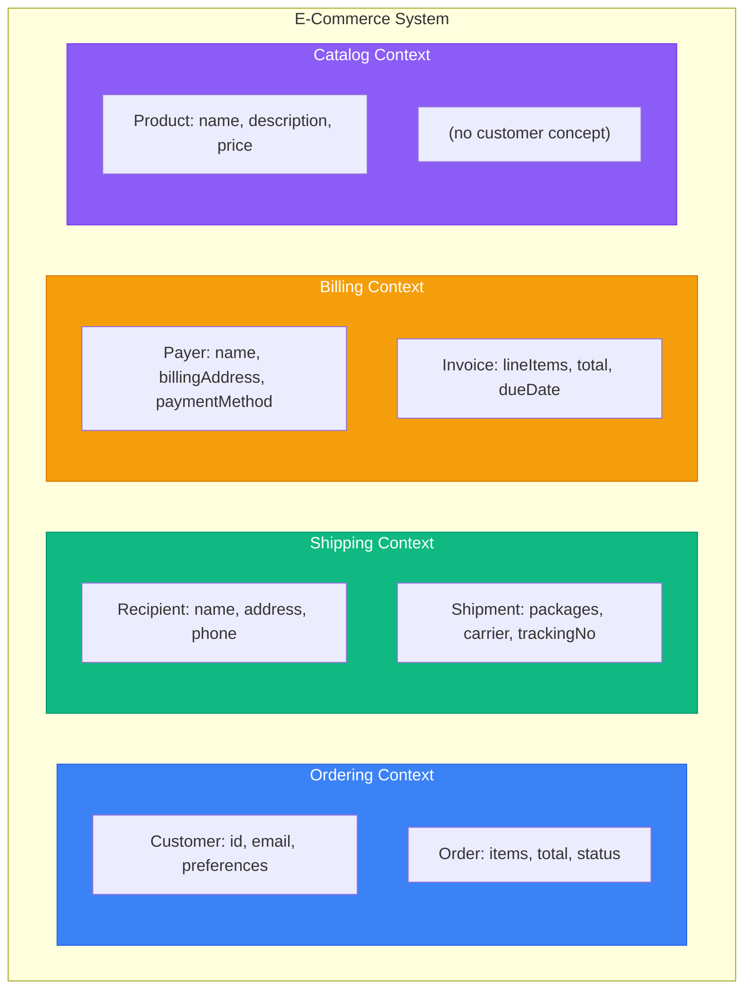
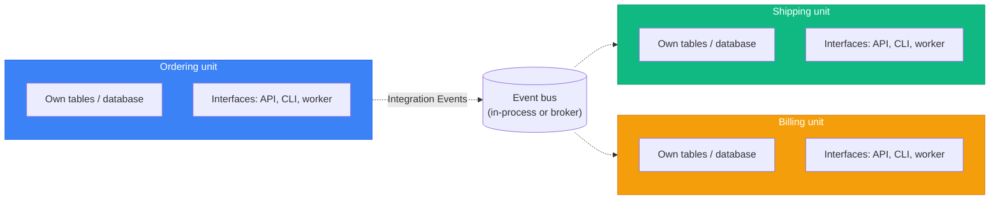
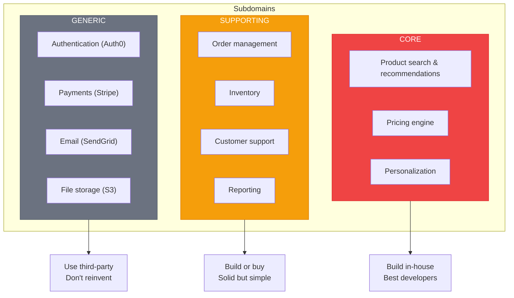

# Bounded Contexts and Subdomains

> Sources:
> - [Domain-Driven Design: The Blue Book](https://www.domainlanguage.com/ddd/blue-book/) — Eric Evans (2003)
> - [DDD Resources](https://www.domainlanguage.com/ddd/) — Domain Language (Eric Evans)
> - [Bounded Context](https://martinfowler.com/bliki/BoundedContext.html) — Martin Fowler
> - [Domain Driven Design](https://martinfowler.com/bliki/DomainDrivenDesign.html) — Martin Fowler
> - [Anti-Corruption Layer](https://docs.aws.amazon.com/prescriptive-guidance/latest/cloud-design-patterns/acl.html) — AWS
> - [Domain Analysis for Microservices](https://learn.microsoft.com/en-us/azure/architecture/microservices/model/domain-analysis) — Microsoft

## Overview

Strategic DDD patterns help decompose large systems into manageable parts with clear boundaries. This guide answers: **"Where does one domain model stop and another begin?"**

**DDD is fundamentally collaborative.** The patterns below emerge from conversations, whiteboarding, and modeling sessions with domain experts—not from coding alone.

---

## Domain Discovery Techniques

### Event Storming

A workshop technique for discovering domain events, aggregates, and bounded contexts.

```
Orange sticky: Domain Event (past tense: "OrderPlaced")
Blue sticky: Command (imperative: "Place Order")
Yellow sticky: Aggregate (noun: "Order")
Pink sticky: External System / Policy
Purple sticky: Problem / Question
```

**Workshop flow:**
1. **Chaotic exploration** — Everyone adds events they know about
2. **Timeline ordering** — Arrange events chronologically
3. **Identify aggregates** — Group related events
4. **Find boundaries** — Where language changes = bounded context boundary
5. **Surface problems** — Mark unclear areas for follow-up

### Context Mapping Workshop

For existing systems, map how bounded contexts currently interact:
1. List all systems/services
2. Identify which team owns each
3. Draw relationships (upstream/downstream)
4. Label relationship types (ACL, Conformist, etc.)
5. Identify pain points in current integrations

---

## Ubiquitous Language

The foundation of DDD. A shared vocabulary between developers and domain experts that appears in:
- Code (class names, method names)
- Documentation
- Conversations
- What users see: UI labels, API resources, CLI commands and their help text

### Principles

1. **One language per bounded context** - Different contexts may use the same word differently
2. **Code reflects the language** - `Order.place()` not `Order.set_status("placed")`
3. **Evolve together** - When language changes, code changes

### Example

```
❌ Technical language:
   "Set the order entity's status field to 2 and insert a record"

✅ Ubiquitous language:
   "Place the order and record that it was placed"
```

```python
# ❌ Technical, not ubiquitous
class Order:
    def set_status(self, status: int) -> None:
        self.status = status


# ✅ Ubiquitous language
# app/bounded_context/ordering/domain/entities/order.py (excerpt)
class Order(AggregateRoot[OrderId]):
    def place(self) -> None:
        if self.status is not OrderStatusEnum.DRAFT:
            raise InvalidOrderTransitionError(  # DomainException, app/exceptions/ordering_errors.py
                str(self.id), self.status.value, OrderStatusEnum.PLACED.value
            )

        self.status = OrderStatusEnum.PLACED
        self.placed_at = Datetime.now()
        self._record(
            OrderPlacedEvent(order_id=self.id, customer_id=self.customer_id, total=self.total)
        )
```

The rejected transition raises a typed domain error, not a built-in, so every interface can
report it the same way (see the [error model](../../errors/error-model.md)). The full
aggregate is in [tactical patterns](../tactical-patterns.md#aggregate).

---

## Bounded Contexts

A **semantic boundary** where a particular domain model applies. Within a bounded context, terms have precise, unambiguous meaning.

> **Key insight:** Polysemy (same word, different meanings) across departments is natural, not a problem. The same term meaning different things in different contexts is expected—"the dominant boundary factor is human culture and language variation." — Martin Fowler

### Key Concepts

- Each bounded context has its **own ubiquitous language**
- Each bounded context has its **own model**
- The same real-world concept may have **different representations** in different contexts

### Example: E-Commerce System



**"Customer" means different things:**
- **Ordering**: Email, preferences, order history
- **Shipping**: Delivery address, phone number
- **Billing**: Payment methods, billing address

Each context keeps its own `Customer`-like class (`Customer`, `Recipient`, `Payer`) in its
own `domain/entities/`. None imports another's, and none moves to the shared kernel because
the fields look alike (see the [shared kernel guide](shared-kernel.md)).

### Bounded Contexts and Deployment Units

A bounded context is a **model** boundary, not a deployment decision. The same context
layout (`bounded_context/<context>/{domain,application,infrastructure}`) is used whatever
the deployment shape; only the unit that is released and extracted changes:

| Shape | Unit of deployment and extraction | Contexts per unit |
| --- | --- | --- |
| Single service | The service | One or more contexts sharing a release cycle |
| Modular monolith | `modules/<module>/`, a future service | One or more contexts per module |
| Microservices | One service per module | One or more contexts per service |

Choosing the shape, and what changes between shapes, is covered by the
[deployment overview](../../deployment/overview.md). A context often ends up as its own
service, but only when it needs independent scaling, release cadence, or ownership; it is
never a reason to start with microservices.



Each unit owns its data and may expose any mix of interfaces; all of them call the same
handlers through the [interface adapter contract](../../interfaces/adapter-contract.md).
Between units, the bus is in-process in a modular monolith and a broker (behind an
outbox) between microservices.

### Integrating Contexts

Contexts never import each other's internal model. Which mechanism connects two contexts
depends on whether they share a module or service; the deployment overview's
[communication patterns](../../deployment/overview.md#communication-patterns) are the
single source of truth:

- **Opaque IDs** when only identity is needed.
- **Application contracts** (an upstream handler's query and DTO) only between contexts
  **inside one module or service**, wrapped by the consumer in its own port and ACL adapter.
- **Integration events** across modules or services, consumed by an event handler that maps
  the contract to a local command; **local projections** fed by those events when a unit
  needs another's data to decide.
- **Request/reply over the network** only between microservices, through a consumer-owned
  port and ACL adapter with timeouts and a circuit breaker.
- **Sagas** for business processes that span units.

Relationship patterns (customer-supplier, conformist, ACL, open host) and worked examples
are in [context mapping](../context-mapping.md). Event delivery, contract shape, and bus
ports are in [communication](../../deployment/communication.md).

---

## Subdomains

Areas of business expertise. Subdomains are **discovered**, not designed.

### Types

| Type | Description | Investment | Example |
|------|-------------|------------|---------|
| **Core** | Competitive advantage | High | Product recommendation engine |
| **Supporting** | Necessary but not unique | Medium | Order management |
| **Generic** | Commodity, buy/outsource | Low | Email sending, payments |

### Identification Questions

1. What makes us different from competitors? → **Core**
2. What do we need but isn't our specialty? → **Supporting**
3. What does everyone need the same way? → **Generic**

### Example: E-Commerce



---

## Review Checklist

- [ ] Context boundaries come from language, ownership, consistency, and lifecycle discovered with domain experts, not from tables, endpoints, or commands.
- [ ] Each context has its own ubiquitous language, and its code uses it (`order.place()`, not `set_status`).
- [ ] The same real-world concept is modelled separately per context; no context imports another's entities or value objects.
- [ ] Expected rule violations raise typed domain errors, so every interface reports them the same way.
- [ ] Subdomains are classified (core, supporting, generic), and investment follows the classification.
- [ ] The deployment shape is chosen per the [deployment overview](../../deployment/overview.md); the context layout is the same in every shape.
- [ ] Cross-context integration uses only the mechanisms the shape allows: IDs, application contracts inside one module or service, integration events and projections across units, request/reply only between microservices.
