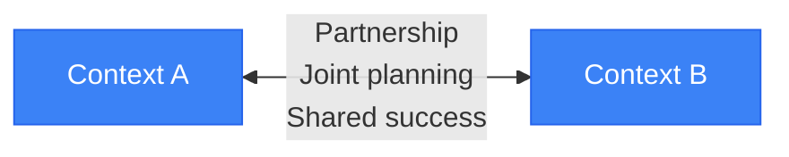
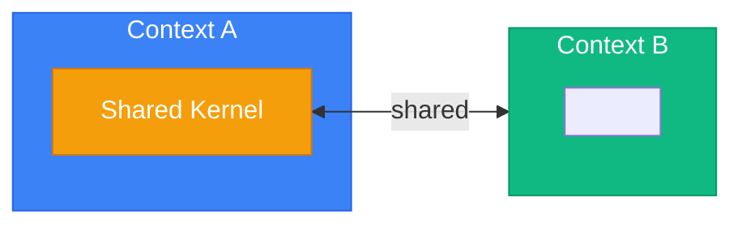
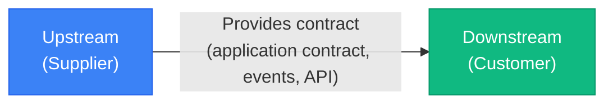
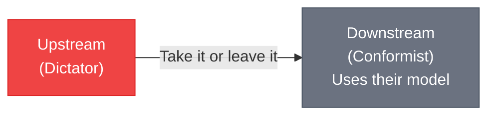
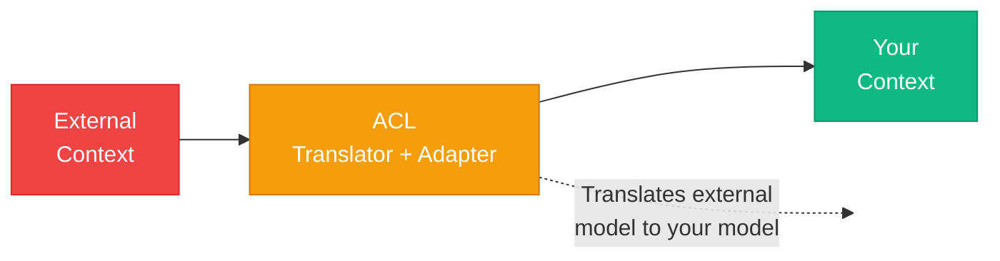
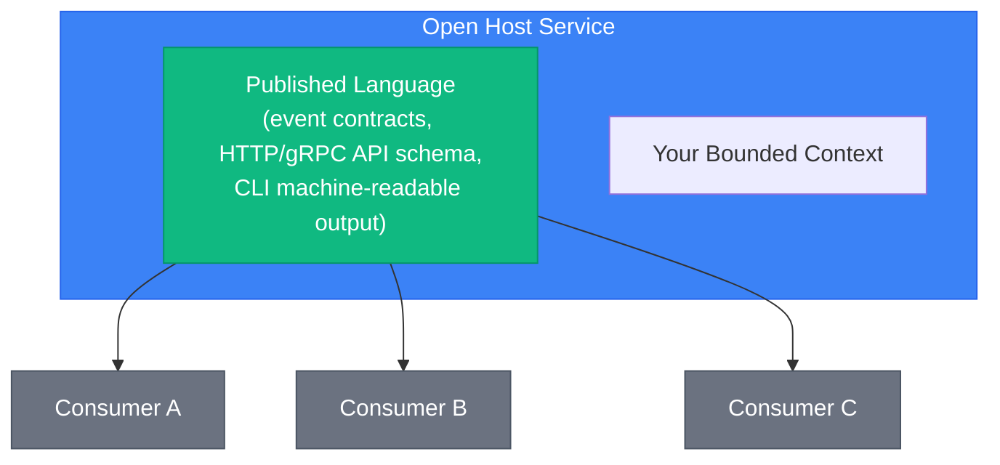
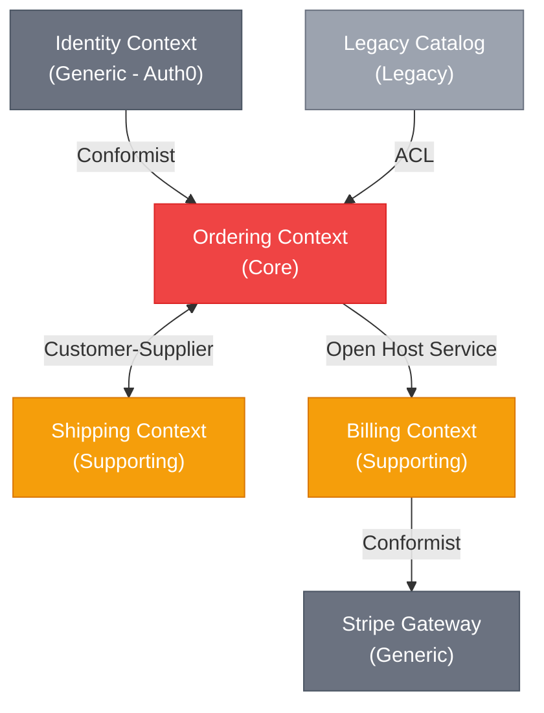

# Context Mapping and Integration

> Sources:
> - [Domain-Driven Design: The Blue Book](https://www.domainlanguage.com/ddd/blue-book/) — Eric Evans (2003)
> - [DDD Resources](https://www.domainlanguage.com/ddd/) — Domain Language (Eric Evans)
> - [Bounded Context](https://martinfowler.com/bliki/BoundedContext.html) — Martin Fowler
> - [Domain Driven Design](https://martinfowler.com/bliki/DomainDrivenDesign.html) — Martin Fowler
> - [Anti-Corruption Layer](https://docs.aws.amazon.com/prescriptive-guidance/latest/cloud-design-patterns/acl.html) — AWS
> - [Domain Analysis for Microservices](https://learn.microsoft.com/en-us/azure/architecture/microservices/model/domain-analysis) — Microsoft

Use this guide after identifying genuine bounded contexts. It explains their upstream/downstream relationships and the translation, event, and contract boundaries that prevent one context's model from leaking into another.

A context map describes **relationships between models and teams**. Which mechanism
carries an integration (an ID, an application contract, an event, a network call) depends
on whether the two contexts share a module, a service, or neither. That choice is owned by
the [deployment overview](../deployment/overview.md#communication-patterns); this guide
follows it and does not restate it.

## Context Mapping

Describes relationships between bounded contexts.

### Relationship Patterns

#### Partnership
Two contexts succeed or fail together. Teams coordinate closely.



#### Shared Kernel
Two contexts share a subset of the model.



**Warning:** Shared kernels create coupling. Use sparingly. In this skill the shared kernel
holds stable technical capabilities and generic primitives only, never a context's
aggregates or business rules; see the [shared kernel guide](bounded-contexts/shared-kernel.md).

#### Customer-Supplier
Upstream context provides what downstream needs.



#### Conformist
Downstream conforms to upstream's model with no negotiation power.



**Example:** Integrating with a third-party API (Stripe, AWS). Even a conformist keeps the
foreign SDK types inside an infrastructure adapter; conforming means adopting the
upstream's concepts, not importing its classes into the domain.

#### Anti-Corruption Layer (ACL)
Translation layer protecting your model from external models.



**Use when:**
- Integrating with legacy systems
- Integrating with third-party APIs
- External model is messy or poorly designed
- Consuming another context of your own system (always, in this skill)

An ACL has two halves in the hexagon. The **outbound** half implements a port the
consuming context owns and translates calls, results, and errors. The **inbound** half
parses what the external system pushes (a webhook, a message) into a local command. Both
are infrastructure, so their concrete classes end in `Adapter`.

```python
# Outbound half. The port is owned by the consuming context:
# app/bounded_context/payments/application/ports/payment_gateway/i_payment_gateway.py
from typing import Protocol

from app.bounded_context.payments.domain.entities import Payment
from app.bounded_context.payments.domain.enums import PaymentStatusEnum


class IPaymentGateway(Protocol):
    async def create_payment(self, payment: Payment) -> str: ...

    def translate_status(self, external_status: str) -> PaymentStatusEnum: ...


# app/bounded_context/payments/infrastructure/outbound/payment_gateway/stripe_payment_gateway_adapter.py
import stripe

from app.bounded_context.payments.application.ports.payment_gateway import IPaymentGateway
from app.bounded_context.payments.domain.entities import Payment
from app.bounded_context.payments.domain.enums import PaymentStatusEnum
from app.exceptions.payments_errors import PaymentGatewayUnavailableError  # InfrastructureException, 503 hint

_STATUS_MAP = {
    "requires_payment_method": PaymentStatusEnum.PENDING,
    "requires_confirmation": PaymentStatusEnum.PENDING,
    "requires_action": PaymentStatusEnum.PENDING,
    "processing": PaymentStatusEnum.PROCESSING,
    "succeeded": PaymentStatusEnum.COMPLETED,
    "canceled": PaymentStatusEnum.CANCELLED,
    "requires_capture": PaymentStatusEnum.AUTHORIZED,
}


class StripePaymentGatewayAdapter(IPaymentGateway):
    def __init__(self, stripe_client: stripe.StripeClient) -> None:
        self._stripe = stripe_client

    async def create_payment(self, payment: Payment) -> str:
        """Translates the domain Payment into a Stripe PaymentIntent."""
        try:
            intent = await self._stripe.payment_intents.create_async(
                params={
                    "amount": payment.amount.to_minor_units(),
                    "currency": payment.amount.currency.lower(),
                    "metadata": {
                        "payment_id": str(payment.id),
                        "order_id": str(payment.order_id),
                    },
                }
            )
        except stripe.StripeError as error:
            raise PaymentGatewayUnavailableError(provider="stripe") from error
        return intent.id

    def translate_status(self, external_status: str) -> PaymentStatusEnum:
        """Translates a Stripe status into the domain PaymentStatusEnum."""
        return _STATUS_MAP.get(external_status, PaymentStatusEnum.UNKNOWN)


# Inbound half: parses the provider's push into a local command, never a domain event.
# app/bounded_context/payments/infrastructure/inbound/webhooks/stripe_webhook_adapter.py
import stripe

from app.bounded_context.payments.application.handlers.commands.complete_payment_handler import (
    CompletePaymentCommand,
)


class StripeWebhookAdapter:
    def to_command(self, event: stripe.Event) -> CompletePaymentCommand | None:
        match event.type:
            case "payment_intent.succeeded":
                intent = event.data.object
                return CompletePaymentCommand(
                    payment_id=intent.metadata["payment_id"],
                    amount_minor_units=intent.amount,
                    currency=intent.currency.upper(),
                )
            case _:
                return None  # events this context does not care about
```

The interface that receives the webhook (an HTTP route, a CLI that replays a file of
events, a worker reading a queue) calls `to_command` and dispatches the command to its
handler. The domain raises its own events when the `Payment` aggregate changes; it never
receives a provider's event.

#### Open Host Service / Published Language
Expose a well-defined protocol for integration.



The published language is owned by the publisher and versioned. Between modules it is the
module's `contracts/` package; between services it is a published distribution or JSON
Schema / OpenAPI document (see [microservices](../deployment/microservices.md#contracts)).
An interface's output models (HTTP schemas, CLI responses) are also a published language
for that interface's callers and are always built from DTOs, as the
[interface adapter contract](../interfaces/adapter-contract.md) requires.

---

## Context Map Diagram

Visual representation of all bounded contexts and their relationships:



---

## Integration Patterns

### Choosing the Mechanism

Map each relationship on the context map to the mechanism the deployment shape allows.
The full table, with what never to do, is
[communication patterns](../deployment/overview.md#communication-patterns):

| Need | Mechanism |
| --- | --- |
| Only the other aggregate's identity | An opaque ID |
| A synchronous answer from a context **in the same module or service** | The upstream's application contract, wrapped in a consumer-owned port and ACL adapter |
| Telling other contexts something happened, across modules or services | A publisher-owned integration event |
| Another unit's data to make a decision | A local projection fed by its events |
| A synchronous answer **between microservices** | Request/reply through a consumer-owned port and ACL adapter with timeouts and a circuit breaker ([details](../deployment/microservices.md#synchronous-communication)) |
| A business process spanning units | A saga or process manager |

Never import another context's entities, value objects, repositories, or ORM models,
whatever the mechanism.

### Application Contract Inside One Module or Service

The downstream context declares the capability it needs as its own port and returns its
own types. The adapter calls the upstream's query handler and translates both the result
and the upstream's errors. It is the ACL; nothing else in ordering knows the customers
context exists.

```python
# app/bounded_context/ordering/application/ports/credit/i_credit_check.py
from typing import Protocol

from app.bounded_context.ordering.domain.value_objects import CustomerId, Money


class ICreditCheck(Protocol):
    async def can_spend(self, customer_id: CustomerId, amount: Money) -> bool: ...


# app/bounded_context/ordering/infrastructure/outbound/customers/customers_credit_check_adapter.py
from decimal import Decimal
from typing import Protocol

from app.bounded_context.customers.application.dtos import CreditLimitDTO
from app.bounded_context.customers.application.handlers.queries.get_credit_limit_handler import (
    GetCreditLimitQuery,
)
from app.bounded_context.ordering.application.ports.credit import ICreditCheck
from app.bounded_context.ordering.domain.value_objects import CustomerId, Money
from app.exceptions.customers_errors import CustomerNotFoundError
from app.exceptions.ordering_errors import UnknownBuyerError


class IGetCreditLimit(Protocol):
    """The upstream's application contract, as this adapter depends on it."""

    async def handle(self, query: GetCreditLimitQuery) -> CreditLimitDTO: ...


class CustomersCreditCheckAdapter(ICreditCheck):
    def __init__(self, get_credit_limit: IGetCreditLimit) -> None:
        self._get_credit_limit = get_credit_limit

    async def can_spend(self, customer_id: CustomerId, amount: Money) -> bool:
        try:
            limit = await self._get_credit_limit.handle(
                GetCreditLimitQuery(customer_id=str(customer_id))
            )
        except CustomerNotFoundError as error:
            raise UnknownBuyerError(str(customer_id)) from error
        return limit.currency == amount.currency and Decimal(limit.available) >= amount.amount
```

The composition root passes the customers context's `GetCreditLimitHandler` into the
adapter. If the two contexts later land in different modules, this call is no longer
allowed: replace it with a projection fed by events, or, between microservices, an adapter
that calls the upstream's API with resilience. Only the adapter changes; the port and the
handlers that use it do not.

### Integration Events Across Modules or Services

The publisher owns a contract that follows the
[contract shape](../deployment/communication.md#contract-shape): a `FrozenObject` with
JSON-native fields, `event_id`, `occurred_at`, `schema_version`, and no `float` money. In a
modular monolith it lives in `modules/<module>/contracts/`; between services it is
published as a versioned distribution.

```python
# app/modules/ordering/contracts/order_placed_event.py
from app.utils import FrozenObject


class AddressContract(FrozenObject):
    street: str
    city: str
    postal_code: str
    country: str


class OrderLineContract(FrozenObject):
    product_id: str
    quantity: int
    unit_price_amount: str  # decimal string
    currency: str


class OrderPlacedEvent(FrozenObject):
    event_id: str
    occurred_at: str  # ISO-8601
    order_id: str
    customer_id: str
    lines: list[OrderLineContract]
    total_amount: str  # decimal string
    currency: str
    shipping_address: AddressContract
    schema_version: int = 1
```

Each consumer is an event handler in its own context. It is the ACL: it maps the contract
to a local command and dispatches it, with no business rule of its own, and is idempotent
on `event_id` (see [communication](../deployment/communication.md#consumer-as-acl)).

```python
# app/modules/shipping/bounded_context/shipping/application/handlers/events/order_placed_handler.py
from app.modules.ordering.contracts.order_placed_event import OrderPlacedEvent
from app.modules.shipping.bounded_context.shipping.application.handlers.commands.create_shipment_handler import (
    CreateShipmentCommand,
    CreateShipmentHandler,
)


class OrderPlacedHandler:
    def __init__(self, create_shipment: CreateShipmentHandler) -> None:
        self._create_shipment = create_shipment

    async def handle(self, event: OrderPlacedEvent) -> None:
        address = event.shipping_address
        await self._create_shipment.handle(
            CreateShipmentCommand(
                external_order_id=event.order_id,
                street=address.street,
                city=address.city,
                postal_code=address.postal_code,
                country=address.country,
                product_quantities={line.product_id: line.quantity for line in event.lines},
            )
        )


# app/modules/billing/bounded_context/invoicing/application/handlers/events/order_placed_handler.py
from app.modules.billing.bounded_context.invoicing.application.handlers.commands.issue_invoice_handler import (
    InvoiceLineInput,
    IssueInvoiceCommand,
    IssueInvoiceHandler,
)
from app.modules.ordering.contracts.order_placed_event import OrderPlacedEvent


class OrderPlacedHandler:
    def __init__(self, issue_invoice: IssueInvoiceHandler) -> None:
        self._issue_invoice = issue_invoice

    async def handle(self, event: OrderPlacedEvent) -> None:
        await self._issue_invoice.handle(
            IssueInvoiceCommand(
                external_order_id=event.order_id,
                billing_customer_id=event.customer_id,
                currency=event.currency,
                lines=[
                    InvoiceLineInput(
                        description=f"Product {line.product_id}",
                        quantity=line.quantity,
                        unit_price_amount=line.unit_price_amount,
                    )
                    for line in event.lines
                ],
            )
        )
```

Shipping turns the order into a `Shipment` with its own `Recipient`; billing turns it into
an `Invoice` with its own `Money`. Neither imports ordering's model, and neither domain
imports the contract: only these handlers do. In a single service, the same handlers live
in `app/bounded_context/<context>/application/handlers/events/`.

### Event Schema Registry

Between services, publish and version each contract's schema so consumers can run
contract tests against it:

```json
{
  "$schema": "https://json-schema.org/draft/2020-12/schema",
  "$id": "https://schemas.example.com/events/ordering/order-placed/v1.json",
  "title": "OrderPlacedEvent",
  "description": "Published when an order is successfully placed",
  "type": "object",
  "required": ["event_id", "occurred_at", "schema_version", "order_id", "total_amount", "currency"],
  "properties": {
    "event_id": { "type": "string", "format": "uuid" },
    "occurred_at": { "type": "string", "format": "date-time" },
    "schema_version": { "const": 1 },
    "order_id": { "type": "string", "format": "uuid" },
    "customer_id": { "type": "string", "format": "uuid" },
    "total_amount": { "type": "string", "pattern": "^[0-9]+(\\.[0-9]+)?$" },
    "currency": { "type": "string", "minLength": 3, "maxLength": 3 }
  }
}
```

A breaking change is a new `schema_version` (or a new event type) published alongside the
old one until every consumer has moved.

---

## Review Checklist

- [ ] Ubiquitous language terms were identified with domain experts.
- [ ] Subdomains are mapped (core, supporting, generic).
- [ ] Bounded context boundaries are defined, and a context map documents each relationship pattern.
- [ ] Every relationship uses a mechanism the deployment shape allows, per the [communication patterns](../deployment/overview.md#communication-patterns).
- [ ] Application contracts are called only inside one module or service, through a consumer-owned port and ACL adapter that translates results and errors.
- [ ] External systems and upstream contexts sit behind ACL adapters; foreign SDK types and upstream errors never reach the domain.
- [ ] Integration contracts are publisher-owned, versioned, JSON-native (no `float` money), and carry `event_id`, `occurred_at`, and `schema_version`.
- [ ] Event consumers only translate a contract into a local command, and are idempotent.
- [ ] Each context owns its data (tables or schema in one database, a database per service); no foreign key, join, or ORM relationship crosses contexts.
