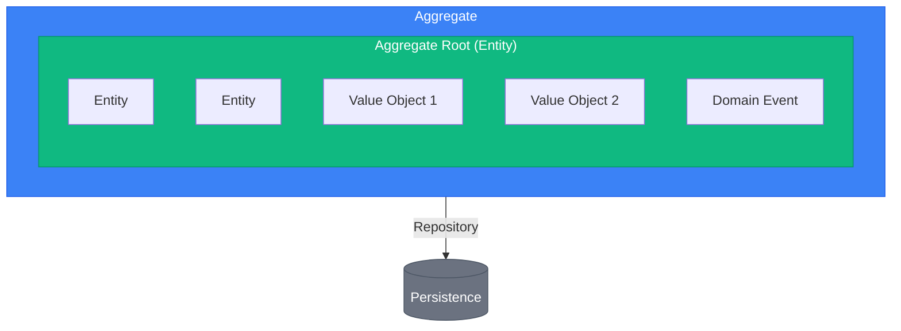
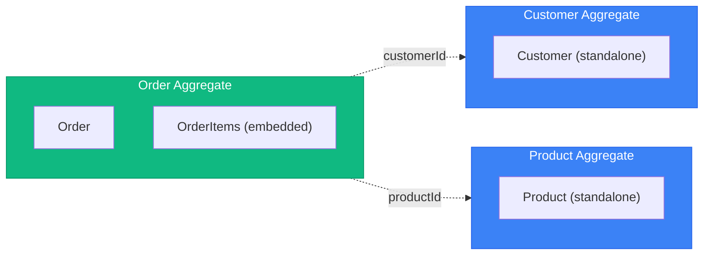
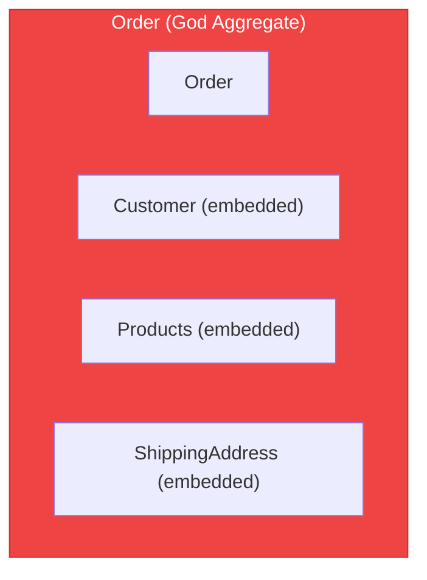

# DDD Tactical Patterns

> Sources:
> - [Domain-Driven Design: The Blue Book](https://www.domainlanguage.com/ddd/blue-book/) — Eric Evans (2003)
> - [Implementing Domain-Driven Design](https://openlibrary.org/works/OL17392277W) — Vaughn Vernon (2013)
> - [Effective Aggregate Design](https://www.dddcommunity.org/library/vernon_2011/) — Vaughn Vernon
> - [Repository Pattern](https://martinfowler.com/eaaCatalog/repository.html) — Martin Fowler (PoEAA)

The examples use the `ordering` context of a service whose package root is `app`, laid out
as in the [project topology](../architecture/project-topology.md). In a modular monolith
the same files sit under `app/modules/<module>/bounded_context/ordering/` (see the
[modular monolith topology](../deployment/modular-monolith-topology.md)). Nothing on this
page depends on what drives the application: a REST API, a CLI, and a worker call the same
handlers, as the [interface adapter contract](../interfaces/adapter-contract.md) requires.
Packages re-export their public classes, so imports name the package rather than the file.

## Building Blocks Overview



| Building block | File | Example |
| --- | --- | --- |
| Shared bases | `app/shared_kernel/domain/{entities,value_objects,events}/` | `Entity`, `AggregateRoot`, `ValueObject`, `DomainEvent` |
| Entity / aggregate root | `app/bounded_context/ordering/domain/entities/<aggregate>.py` | `Order`, `OrderItem` |
| Value object | `.../domain/value_objects/<value>.py` | `Money`, `OrderId` |
| Enum | `.../domain/enums/<name>_enum.py` | `OrderStatusEnum` |
| Domain event | `.../domain/events/<fact>_event.py` | `OrderPlacedEvent` |
| Domain service, factory | `.../domain/services/<name>_service.py`, `order_factory.py` | `PricingService`, `OrderFactory` |
| Write repository port | `.../domain/repositories/i_<aggregate>_repository.py` | `IOrderRepository` |
| Unit of Work port | `.../application/ports/transactions/i_ordering_unit_of_work.py` | `IOrderingUnitOfWork` |
| Unit of Work adapter | `.../infrastructure/outbound/persistence/ordering_unit_of_work_adapter.py` | `SqlOrderingUnitOfWorkAdapter` |

### Errors Used on This Page

An expected failure raises a typed project error, never `ValueError` or another built-in
(see the [error model](../errors/error-model.md)). A broken invariant is a
`DomainException` subclass. `OrderNotFoundError` (ORD-001) and `OrderAlreadyShippedError`
(ORD-002) are defined in the error model; codes added for this page use `ORD-2xx`. In a single service the ordering errors live in
`app/exceptions/ordering_errors.py`; in a modular monolith they move to
`modules/<module>/exceptions/ordering/domain.py`. The `__http_error__` hint names an
outcome class: an HTTP interface returns it as the status, a CLI maps it to an exit code,
a worker to retry or dead-letter.

```python
# app/exceptions/ordering_errors.py (domain subset used on this page)
from decimal import Decimal

from app.exceptions.base import DomainException


class OrderAlreadyShippedError(DomainException):
    __error_code__ = "ORD-002"
    __http_error__ = 409

    def __init__(self, order_id: str) -> None:
        super().__init__(
            f"Order '{order_id}' has already shipped and cannot change.",
            metadata={"order_id": order_id},
        )


class EmptyOrderError(DomainException):
    __error_code__ = "ORD-003"

    def __init__(self, order_id: str) -> None:
        super().__init__(
            f"Order '{order_id}' has no items and cannot be placed.",
            metadata={"order_id": order_id},
        )


class CurrencyMismatchError(DomainException):
    __error_code__ = "ORD-004"

    def __init__(self, left: str, right: str) -> None:
        super().__init__(
            f"Cannot combine amounts in {left} and {right}.",
            metadata={"currencies": [left, right]},
        )


class NegativeAmountError(DomainException):
    __error_code__ = "ORD-201"

    def __init__(self, amount: Decimal, currency: str) -> None:
        super().__init__(
            f"An amount cannot be negative, got {amount} {currency}.",
            metadata={"amount": str(amount), "currency": currency},
        )


class InvalidQuantityError(DomainException):
    __error_code__ = "ORD-202"

    def __init__(self, quantity: int) -> None:
        super().__init__(
            f"Quantity must be positive, got {quantity}.", metadata={"quantity": quantity}
        )


class OrderNotModifiableError(DomainException):
    __error_code__ = "ORD-203"
    __http_error__ = 409

    def __init__(self, order_id: str, status: str) -> None:
        super().__init__(
            f"Order '{order_id}' is {status}; its items can no longer change.",
            metadata={"order_id": order_id, "status": status},
        )


class InvalidOrderTransitionError(DomainException):
    __error_code__ = "ORD-204"
    __http_error__ = 409

    def __init__(self, order_id: str, current: str, target: str) -> None:
        super().__init__(
            f"Order '{order_id}' cannot move from {current} to {target}.",
            metadata={"order_id": order_id, "current": current, "target": target},
        )


class OrderItemNotFoundError(DomainException):
    __error_code__ = "ORD-205"

    def __init__(self, order_id: str, product_id: str) -> None:
        super().__init__(
            f"Order '{order_id}' has no item for product '{product_id}'.",
            metadata={"order_id": order_id, "product_id": product_id},
        )


class EmptyCartError(DomainException):
    __error_code__ = "ORD-206"

    def __init__(self, cart_id: str) -> None:
        super().__init__(
            f"Cart '{cart_id}' is empty; there is nothing to order.",
            metadata={"cart_id": cart_id},
        )
```

---

## Entity

An object with **identity** that persists through time. Two entities are equal if they have the same identity, regardless of attribute values.

### Characteristics

- Has a unique identifier
- Identity persists through lifecycle
- Can change attributes but remains the same entity
- Contains behavior (not just data)

### Pattern

The base lives in the shared kernel because every context uses the same identity
semantics. It carries no business meaning.

```python
# app/shared_kernel/domain/entities/entity.py
from dataclasses import dataclass


@dataclass(slots=True, kw_only=True, eq=False)
class Entity[IdT]:
    """Base for entities: equality and hashing follow identity, never attributes."""

    id: IdT

    def __eq__(self, other: object) -> bool:
        return isinstance(other, Entity) and type(other) is type(self) and other.id == self.id

    def __hash__(self) -> int:
        return hash((type(self), self.id))
```

Every subclass is declared with `@dataclass(slots=True, kw_only=True, eq=False)`. A plain `@dataclass`
would generate a field-by-field `__eq__` and set `__hash__` to `None`, silently replacing
identity equality.

Each entity exposes a factory classmethod, `create(...) -> Self`, that enforces creation
invariants. The base does not declare it abstractly, because each entity's factory takes
different arguments. Slotted dataclasses cannot use zero-argument `super()`; entities do
not need it.

```python
# app/bounded_context/ordering/domain/value_objects/order_id.py
from uuid import UUID, uuid4

from pydantic import Field

from app.shared_kernel.domain.value_objects import ValueObject


class OrderId(ValueObject):
    value: UUID = Field(default_factory=uuid4)


# app/bounded_context/ordering/domain/value_objects/order_item_id.py: same shape as OrderId
class OrderItemId(ValueObject):
    value: UUID = Field(default_factory=uuid4)


# app/bounded_context/ordering/domain/value_objects/customer_id.py: same shape.
# When it references an aggregate created elsewhere, pass the existing value:
# CustomerId(value=known_uuid). The default only serves tests and new identities.
class CustomerId(ValueObject):
    value: UUID = Field(default_factory=uuid4)


# app/bounded_context/ordering/domain/value_objects/product_id.py: same shape
class ProductId(ValueObject):
    value: UUID = Field(default_factory=uuid4)


# app/bounded_context/ordering/domain/entities/order_item.py
from dataclasses import dataclass, field
from typing import Self

from app.bounded_context.ordering.domain.value_objects import (
    Datetime,
    Money,
    OrderItemId,
    ProductId,
)
from app.exceptions.ordering_errors import InvalidQuantityError
from app.shared_kernel.domain.entities import Entity


@dataclass(slots=True, kw_only=True, eq=False)
class OrderItem(Entity[OrderItemId]):
    product_id: ProductId
    quantity: int
    unit_price: Money
    created_at: Datetime = field(default_factory=Datetime.now)

    @classmethod
    def create(cls, product_id: ProductId, quantity: int, unit_price: Money) -> Self:
        if quantity <= 0:
            raise InvalidQuantityError(quantity)
        return cls(
            id=OrderItemId(),
            product_id=product_id,
            quantity=quantity,
            unit_price=unit_price,
        )

    def increase_quantity(self, amount: int) -> None:
        if amount <= 0:
            raise InvalidQuantityError(amount)
        self.quantity += amount

    def subtotal(self) -> Money:
        return self.unit_price.multiply(self.quantity)
```

---

## Value Object

An object defined by its **attributes**, not identity. Two value objects are equal if all their attributes are equal.

### Characteristics

- Immutable (frozen)
- No identity
- Equality by value (all attributes)
- Self-validating
- Side-effect-free methods

> **Scope note:** everything below is the VO as a domain building block. A VO is never
> returned directly from an application handler (command or query); map it to a DTO
> first. See the [naming rules](../architecture/project-topology.md#naming) and the worked
> examples in [CQRS implementation](../cqrs/implementation.md).

### Common Value Objects

| Value Object | Attributes | Validation |
|--------------|-----------|------------|
| Money | amount (`Decimal`), currency | amount >= 0 |
| Email | value | valid email format |
| Phone | value | valid phone format |
| Datetime | value | timezone-aware datetime |

### Pattern

`FrozenObject` is the technical primitive (immutable, validated, equal by value) behind
value objects, domain events, DTOs, and integration contracts. It lives in `app/utils/`.
`ValueObject` is the domain-facing base built on it in the shared kernel.

```python
# app/utils/__init__.py
from pydantic import BaseModel, ConfigDict


class FrozenObject(BaseModel):
    model_config = ConfigDict(frozen=True, from_attributes=True)


# app/shared_kernel/domain/value_objects/value_object.py
from app.utils import FrozenObject


class ValueObject(FrozenObject):
    """Base for domain value objects: immutable, equal by value, self-validating."""

    def __str__(self) -> str:
        if "value" in type(self).model_fields:
            return str(getattr(self, "value"))
        return super().__str__()


# app/bounded_context/ordering/domain/value_objects/money.py
from __future__ import annotations  # methods annotate with their own class

from decimal import Decimal
from typing import Self

from pydantic import model_validator

from app.exceptions.ordering_errors import CurrencyMismatchError, NegativeAmountError
from app.shared_kernel.domain.value_objects import ValueObject


class Money(ValueObject):
    amount: Decimal  # never float: binary floats cannot represent most cents exactly
    currency: str

    @model_validator(mode="after")
    def _check_non_negative(self) -> Self:
        # Pydantic wraps only ValueError/AssertionError; a DomainException propagates as-is.
        if self.amount < 0:
            raise NegativeAmountError(self.amount, self.currency)
        return self

    def add(self, other: Money) -> Money:
        self._ensure_same_currency(other)
        return Money(amount=self.amount + other.amount, currency=self.currency)

    def subtract(self, other: Money) -> Money:
        self._ensure_same_currency(other)
        return Money(amount=self.amount - other.amount, currency=self.currency)

    def multiply(self, factor: Decimal | int) -> Money:
        # Round where the business defines it (per line, per invoice), not here.
        return Money(amount=self.amount * factor, currency=self.currency)

    @classmethod
    def zero(cls, currency: str) -> Money:
        return cls(amount=Decimal(0), currency=currency)

    def _ensure_same_currency(self, other: Money) -> None:
        if other.currency != self.currency:
            raise CurrencyMismatchError(self.currency, other.currency)


# app/bounded_context/ordering/domain/value_objects/email.py
from pydantic import EmailStr  # requires the pydantic[email] extra


class Email(ValueObject):
    value: EmailStr

    @property
    def domain(self) -> str:
        return str(self.value).split("@")[1]


# app/bounded_context/ordering/domain/value_objects/phone.py
class Phone(ValueObject):
    value: str


# app/bounded_context/ordering/domain/value_objects/datetime.py
from __future__ import annotations

from datetime import UTC, datetime


class Datetime(ValueObject):
    value: datetime

    @classmethod
    def now(cls) -> Datetime:
        return cls(value=datetime.now(UTC))

    def __str__(self) -> str:
        return self.value.isoformat()


# app/bounded_context/ordering/domain/value_objects/address.py
class Address(ValueObject):
    street: str
    city: str
    postal_code: str
    country: str  # ISO 3166-1 alpha-2
```

A value object that several contexts genuinely share with the same meaning may move to
`app/shared_kernel/domain/value_objects/` by deliberate agreement (see the
[shared kernel guide](bounded-contexts/shared-kernel.md)). By default each context keeps
its own, even when the fields look alike.

---

## Aggregate

A cluster of entities and value objects treated as a single unit for data changes. Has a **consistency boundary**.

### Rules

1. **One aggregate root** - Single entry point for all modifications
2. **Reference by ID only** - Aggregates reference others by identity, never by direct object reference
3. **Transaction boundary** - One aggregate per transaction (eventual consistency between aggregates)
4. **Invariants within boundary** - Aggregate ensures its own consistency
5. **Small aggregates** - Prefer smaller over larger

### Aggregate Sizing Heuristics

| Metric | Healthy | Warning | Action |
|--------|---------|---------|--------|
| Entities per aggregate | 1-5 | 6-10 | >10: Split |
| Lines of code (root) | <500 | 500-1000 | >1000: Split |
| Transaction lock time | <100ms | 100-500ms | >500ms: Split |
| Concurrent modification conflicts | Rare | Occasional | Frequent: Split |

**Questions to ask:**
- Can parts be eventually consistent? → Separate aggregates
- Do all parts change together? → Same aggregate
- Are there independent lifecycles? → Separate aggregates

### Design Guidelines

**Good: Small Aggregates**



*Reference by ID only*

**Bad: God Aggregate**



*Too large, too many reasons to change, contention issues*

### Pattern

The aggregate root records domain events while it changes. `domain_events` reads them;
the application layer calls `pull_domain_events()` (read and clear) once the change is
persisted.

```python
# app/shared_kernel/domain/entities/aggregate_root.py
from dataclasses import dataclass, field

from app.shared_kernel.domain.entities.entity import Entity
from app.shared_kernel.domain.events import DomainEvent


@dataclass(slots=True, kw_only=True, eq=False)
class AggregateRoot[IdT](Entity[IdT]):
    """Entity that guards an aggregate's invariants and records its domain events."""

    _events: list[DomainEvent] = field(default_factory=list, init=False, repr=False)

    @property
    def domain_events(self) -> tuple[DomainEvent, ...]:
        return tuple(self._events)

    def pull_domain_events(self) -> tuple[DomainEvent, ...]:
        events = tuple(self._events)
        self._events.clear()
        return events

    def _record(self, event: DomainEvent) -> None:
        self._events.append(event)


# app/bounded_context/ordering/domain/enums/order_status_enum.py
from enum import StrEnum


class OrderStatusEnum(StrEnum):
    DRAFT = "draft"
    PLACED = "placed"
    SHIPPED = "shipped"
    DELIVERED = "delivered"
    CANCELLED = "cancelled"


# app/bounded_context/ordering/domain/entities/order.py
from dataclasses import dataclass, field
from typing import Self

from app.bounded_context.ordering.domain.entities.order_item import OrderItem
from app.bounded_context.ordering.domain.enums import OrderStatusEnum
from app.bounded_context.ordering.domain.events import OrderPlacedEvent
from app.bounded_context.ordering.domain.value_objects import (
    CustomerId,
    Datetime,
    Money,
    OrderId,
    ProductId,
)
from app.exceptions.ordering_errors import (
    CurrencyMismatchError,
    EmptyOrderError,
    InvalidOrderTransitionError,
    OrderAlreadyShippedError,
    OrderItemNotFoundError,
    OrderNotModifiableError,
)
from app.shared_kernel.domain.entities import AggregateRoot

_LOCKED_STATUSES = frozenset(
    {OrderStatusEnum.SHIPPED, OrderStatusEnum.DELIVERED, OrderStatusEnum.CANCELLED}
)


@dataclass(slots=True, kw_only=True, eq=False)
class Order(AggregateRoot[OrderId]):
    customer_id: CustomerId
    currency: str = "EUR"
    status: OrderStatusEnum = OrderStatusEnum.DRAFT
    items: tuple[OrderItem, ...] = ()  # replaced by the root, never appended to by callers
    created_at: Datetime = field(default_factory=Datetime.now)
    updated_at: Datetime = field(default_factory=Datetime.now)
    placed_at: Datetime | None = None
    cancellation_reason: str | None = None

    @classmethod
    def create(cls, *, customer_id: CustomerId, currency: str = "EUR") -> Self:
        """Factory classmethod: start a draft order."""
        return cls(id=OrderId(), customer_id=customer_id, currency=currency)

    def add_item(self, product_id: ProductId, quantity: int, unit_price: Money) -> None:
        """Add an item, or increase its quantity if the product is already ordered."""
        self._ensure_modifiable()
        if unit_price.currency != self.currency:
            raise CurrencyMismatchError(self.currency, unit_price.currency)

        existing_item = self._find_item(product_id)
        if existing_item is not None:
            existing_item.increase_quantity(quantity)
        else:
            new_item = OrderItem.create(
                product_id=product_id, quantity=quantity, unit_price=unit_price
            )
            self.items = (*self.items, new_item)
        self._touch()

    def remove_item(self, product_id: ProductId) -> None:
        self._ensure_modifiable()
        item = self._find_item(product_id)
        if item is None:
            raise OrderItemNotFoundError(str(self.id), str(product_id))
        self.items = tuple(other for other in self.items if other is not item)
        self._touch()

    def place(self, *, at: Datetime | None = None) -> None:
        """Place a draft order: the customer commits to buy."""
        if self.status is not OrderStatusEnum.DRAFT:
            raise InvalidOrderTransitionError(
                str(self.id), self.status.value, OrderStatusEnum.PLACED.value
            )
        if not self.items:
            raise EmptyOrderError(str(self.id))

        self.status = OrderStatusEnum.PLACED
        self.placed_at = at or Datetime.now()  # `at` lets callers and tests pass the clock
        self._touch()
        self._record(
            OrderPlacedEvent(order_id=self.id, customer_id=self.customer_id, total=self.total)
        )

    def ship(self) -> None:
        if self.status is not OrderStatusEnum.PLACED:
            raise InvalidOrderTransitionError(
                str(self.id), self.status.value, OrderStatusEnum.SHIPPED.value
            )
        self.status = OrderStatusEnum.SHIPPED
        self._touch()

    def cancel(self, reason: str) -> None:
        if self.status in {OrderStatusEnum.SHIPPED, OrderStatusEnum.DELIVERED}:
            raise OrderAlreadyShippedError(str(self.id))
        self.status = OrderStatusEnum.CANCELLED
        self.cancellation_reason = reason
        self._touch()

    @property
    def total(self) -> Money:
        total = Money.zero(self.currency)
        for item in self.items:
            total = total.add(item.subtotal())
        return total

    @property
    def item_count(self) -> int:
        """Total number of units (sum of quantities)."""
        return sum(item.quantity for item in self.items)

    def _ensure_modifiable(self) -> None:
        if self.status in _LOCKED_STATUSES:
            raise OrderNotModifiableError(str(self.id), self.status.value)

    def _find_item(self, product_id: ProductId) -> OrderItem | None:
        return next((item for item in self.items if item.product_id == product_id), None)

    def _touch(self) -> None:
        self.updated_at = Datetime.now()
```

Methods are named in the ubiquitous language (`place`, `ship`, `cancel`), never
`set_status`. Equality comes from `Entity`; the aggregate does not redefine it. `items` is
a tuple, so the only way to change the collection is through the root's methods.

---

## Domain Event

A fact that happened inside the context, named in the past tense. The aggregate records it;
the command handler pulls it after the change is persisted and dispatches it to the
context's own handlers, or maps it to an integration contract for other contexts.

```python
# app/shared_kernel/domain/events/domain_event.py
from datetime import UTC, datetime
from uuid import UUID, uuid4

from pydantic import Field

from app.utils import FrozenObject


class DomainEvent(FrozenObject):
    """A fact inside one context. Never published as-is to another context."""

    event_id: UUID = Field(default_factory=uuid4)
    occurred_at: datetime = Field(default_factory=lambda: datetime.now(UTC))


# app/bounded_context/ordering/domain/events/order_placed_event.py
from app.bounded_context.ordering.domain.value_objects import CustomerId, Money, OrderId
from app.shared_kernel.domain.events import DomainEvent


class OrderPlacedEvent(DomainEvent):
    order_id: OrderId
    customer_id: CustomerId
    total: Money
```

A domain event may carry the context's value objects because it never leaves the context.
An integration contract for other modules or services carries only JSON-native values;
see the [contract shape](../deployment/communication.md#contract-shape) and
[CQRS events](../cqrs/events.md) for the difference, the outbox, and idempotent handlers.

---

## Repository

Provides collection-like access to aggregates. Abstracts persistence.

### Rules

1. **One repository per aggregate** - Not per entity or table
2. **Domain interface** - Port in `domain/repositories/`, adapter in `infrastructure/outbound/persistence/repositories/`
3. **Aggregate-focused** - Save/load entire aggregates
4. **No query logic** - Listings, counts, and reports belong in read ports that return DTOs

### Pattern

```python
# app/bounded_context/ordering/domain/repositories/i_order_repository.py
import abc

from app.bounded_context.ordering.domain.entities import Order
from app.bounded_context.ordering.domain.value_objects import CustomerId, OrderId


class IOrderRepository(abc.ABC):
    """Write repository port for the Order aggregate."""

    @abc.abstractmethod
    async def get_by_id(self, order_id: OrderId) -> Order | None: ...

    @abc.abstractmethod
    async def save(self, order: Order) -> None: ...

    @abc.abstractmethod
    async def delete(self, order_id: OrderId) -> None: ...

    # Only when a command must load these aggregates to change them;
    # a listing for display goes through the read port instead.
    @abc.abstractmethod
    async def get_by_customer_id(self, customer_id: CustomerId) -> list[Order]: ...


# Note: a Protocol can be used instead of an ABC when the project prefers structural typing.
# from typing import Protocol
#
# class IOrderRepository(Protocol):
#     async def get_by_id(self, order_id: OrderId) -> Order | None: ...
#     async def save(self, order: Order) -> None: ...
```

The adapter (`SqlOrderRepositoryAdapter` in
`.../infrastructure/outbound/persistence/repositories/sql_order_repository_adapter.py`)
converts between ORM models and the aggregate through
`.../persistence/mappers/order_mapper.py` (`OrderMapper.to_orm` / `to_entity`), and
translates driver errors into `InfrastructureException` subclasses.

### Common Mistakes

**Wrong: Repository per entity**

```python
# Don't do this
class IOrderItemRepository(Protocol):
    async def find_by_order_id(self, order_id: OrderId) -> list[OrderItem]: ...
    async def save(self, item: OrderItem) -> None: ...
```

**Wrong: Query methods in repository**

```python
# Don't do this
class IOrderRepository(Protocol):
    async def find_by_status(self, status: OrderStatusEnum) -> list[Order]: ...
    async def find_by_date_range(self, start: datetime, end: datetime) -> list[Order]: ...
    async def count_by_customer(self, customer_id: CustomerId) -> int: ...
```

**Correct: Aggregate-focused + separate read model**

```python
# app/bounded_context/ordering/domain/repositories/i_order_repository.py
class IOrderRepository(abc.ABC):
    @abc.abstractmethod
    async def get_by_id(self, order_id: OrderId) -> Order | None: ...

    @abc.abstractmethod
    async def save(self, order: Order) -> None: ...


# app/bounded_context/ordering/application/ports/read_repositories/i_order_read_repository.py
class IOrderReadRepository(abc.ABC):
    @abc.abstractmethod
    async def find_by_status(self, status: OrderStatusEnum) -> list[OrderDTO]: ...

    @abc.abstractmethod
    async def find_by_date_range(self, start: datetime, end: datetime) -> list[OrderDTO]: ...

    @abc.abstractmethod
    async def count_by_customer(self, customer_id: str) -> int: ...
```

---

## Domain Service

Stateless operations that don't naturally fit within an entity or value object.

### When to Use

- Operation involves multiple aggregates
- Operation requires information the caller loads and passes in (a domain service performs no I/O)
- Significant business logic that doesn't belong to one entity

### Pattern

```python
# app/bounded_context/ordering/domain/services/pricing_service.py
from decimal import Decimal

from app.bounded_context.ordering.domain.entities import Customer, Order
from app.bounded_context.ordering.domain.value_objects import Money

_BULK_RATE = Decimal("0.05")
_VIP_RATE = Decimal("0.10")
_MAX_RATE = Decimal("0.20")


class PricingService:
    """Domain service for calculating discounts.

    `Customer` is ordering's own model of a buyer (kept up to date from the
    customers context's events), not a class imported from that context.
    """

    def calculate_discount(self, order: Order, customer: Customer) -> Money:
        total = order.total
        discount = Money.zero(total.currency)

        if order.item_count > 10:
            discount = discount.add(total.multiply(_BULK_RATE))

        if customer.is_vip:
            discount = discount.add(total.multiply(_VIP_RATE))

        # Cap discount at 20%
        return min(discount, total.multiply(_MAX_RATE), key=lambda money: money.amount)


# app/bounded_context/ordering/domain/services/shipping_cost_service.py
from decimal import Decimal

from app.bounded_context.ordering.domain.entities import OrderItem
from app.bounded_context.ordering.domain.value_objects import Address, Money

_HOME_COUNTRY = "US"


class ShippingCostService:
    """Domain service for calculating shipping costs."""

    def calculate(self, items: list[OrderItem], destination: Address) -> Money:
        base_rate = Money(amount=Decimal("5.99"), currency="USD")
        per_item_rate = Money(amount=Decimal("1.50"), currency="USD")

        total = base_rate.add(per_item_rate.multiply(len(items)))

        if destination.country != _HOME_COUNTRY:
            total = total.add(Money(amount=Decimal("15.00"), currency="USD"))

        return total
```

---

## Unit of Work (UoW)

The Unit of Work pattern maintains a list of objects affected by a business transaction and coordinates writing out changes.
The port belongs to the application layer (transaction coordination is a use-case
concern); the adapter lives with the context's persistence code.

### Pattern

```python
# app/bounded_context/ordering/application/ports/transactions/i_ordering_unit_of_work.py
import abc
from types import TracebackType
from typing import Self

from app.bounded_context.ordering.domain.repositories import IOrderRepository


class IOrderingUnitOfWork(abc.ABC):
    """One transaction over the ordering context's write repositories."""

    orders: IOrderRepository

    @abc.abstractmethod
    async def __aenter__(self) -> Self: ...

    @abc.abstractmethod
    async def __aexit__(
        self,
        exc_type: type[BaseException] | None,
        exc: BaseException | None,
        tb: TracebackType | None,
    ) -> None: ...

    @abc.abstractmethod
    async def commit(self) -> None: ...

    @abc.abstractmethod
    async def rollback(self) -> None: ...


# app/bounded_context/ordering/infrastructure/outbound/persistence/ordering_unit_of_work_adapter.py
from types import TracebackType
from typing import Self

from sqlalchemy.ext.asyncio import AsyncSession, async_sessionmaker

from app.bounded_context.ordering.application.ports.transactions import IOrderingUnitOfWork
from app.bounded_context.ordering.infrastructure.outbound.persistence.repositories import (
    SqlOrderRepositoryAdapter,
)


class SqlOrderingUnitOfWorkAdapter(IOrderingUnitOfWork):
    def __init__(self, session_factory: async_sessionmaker[AsyncSession]) -> None:
        self._session_factory = session_factory
        self._session: AsyncSession | None = None

    async def __aenter__(self) -> Self:
        self._session = self._session_factory()
        self.orders = SqlOrderRepositoryAdapter(self._session)
        return self

    async def __aexit__(
        self,
        exc_type: type[BaseException] | None,
        exc: BaseException | None,
        tb: TracebackType | None,
    ) -> None:
        session = self._require_session()
        try:
            if exc_type is not None:
                await session.rollback()
        finally:
            await session.close()  # uncommitted work is discarded
            self._session = None

    async def commit(self) -> None:
        # Translate driver errors (IntegrityError, OperationalError) into
        # InfrastructureException subclasses here, with `raise ... from error`.
        await self._require_session().commit()

    async def rollback(self) -> None:
        await self._require_session().rollback()

    def _require_session(self) -> AsyncSession:
        if self._session is None:
            # A programming bug, not an expected failure: a built-in is correct here.
            raise RuntimeError("Use the unit of work inside 'async with'.")
        return self._session
```

A command handler receives a UoW factory from the composition root and owns the
transaction. Every interface (API, CLI, worker) gets the same handler:

```python
# inside ShipOrderHandler.handle, app/bounded_context/ordering/application/handlers/commands/ship_order_handler.py
# (PlaceOrderHandler, which creates the order, is in CQRS implementation)
async with self._uow_factory() as uow:
    order = await uow.orders.get_by_id(OrderId(value=action.order_id))
    if order is None:
        raise OrderNotFoundError(str(action.order_id))  # ApplicationException, see the error model
    order.ship()
    await uow.orders.save(order)
    await uow.commit()
events = order.pull_domain_events()  # dispatch after commit
```

When several contexts repeat the `__aenter__`/`__aexit__`/`commit`/`rollback` contract, a
project may factor it into a generic base in `shared_kernel/application/ports/transactions/`;
the context-specific port still names its repositories. Wiring is in the
[composition root](../architecture/composition-root.md); handler shapes are in
[CQRS implementation](../cqrs/implementation.md).

---

## Factory

Encapsulates complex aggregate/entity creation.

### When to Use

- Creation logic is complex
- Need to enforce invariants during creation
- Need to create object graphs

For a single aggregate whose creation needs only its own data, a factory classmethod on
the aggregate is enough (`Order.create`). Use a factory class in
`domain/services/order_factory.py` when creation reads other aggregates of the same
context.

### Pattern

```python
# app/bounded_context/ordering/domain/services/order_factory.py
from app.bounded_context.ordering.domain.entities import Cart, Customer, Order
from app.exceptions.ordering_errors import EmptyCartError


class OrderFactory:
    """Factory for creating orders from other aggregates of the ordering context."""

    def create_from_cart(self, cart: Cart, customer: Customer) -> Order:
        """Create a draft order from a shopping cart."""
        if not cart.items:
            raise EmptyCartError(str(cart.id))

        order = Order.create(customer_id=customer.id, currency=cart.currency)

        for cart_item in cart.items:
            order.add_item(
                product_id=cart_item.product_id,
                quantity=cart_item.quantity,
                unit_price=cart_item.unit_price,
            )

        return order
```

---

## Specification

A named, reusable business predicate (`is_satisfied_by(candidate) -> bool`), composable
via AND/OR/NOT. Use it when the same business rule is checked in 2+ places (validating
a candidate, selecting from a collection/repository, or constraining what a factory
builds) — not for a one-off `if`, and not as a substitute for an ordinary CQRS query
filter. It lives in `domain/specifications/<rule>_specification.py`. It is neither a domain
service (it answers yes/no instead of performing an operation) nor a mapper; see
[placement rules](../architecture/project-topology.md#placing-non-entity-code). See
[the specification pattern](../patterns/specification.md) for the full pattern, all three uses,
and the composable base classes.

---

## Review Checklist

- [ ] Entities and aggregates live in `domain/entities/`, value objects in `domain/value_objects/`, enums (suffix `Enum`) in `domain/enums/`, events (suffix `Event`) in `domain/events/`.
- [ ] Shared bases (`Entity`, `AggregateRoot`, `ValueObject`, `DomainEvent`) come from `shared_kernel/domain/`; `FrozenObject` comes from `utils/`.
- [ ] Entity subclasses use `@dataclass(slots=True, kw_only=True, eq=False)` so equality and hashing follow identity.
- [ ] Value objects are frozen and self-validating; money uses `Decimal` (or integer minor units), never `float`.
- [ ] Every expected failure raises a typed `DomainException` (or `ApplicationException`) subclass; no `ValueError` or other built-in signals a business outcome.
- [ ] Aggregates are small, reference other aggregates by ID, change only through methods named in the ubiquitous language, and record domain events exposed as `domain_events`.
- [ ] One write repository per aggregate, as a port in `domain/repositories/`; listings and counts use read ports returning DTOs.
- [ ] The Unit of Work port is `application/ports/transactions/i_<context>_unit_of_work.py`; its concrete class ends in `Adapter`.
- [ ] Domain services and factories are stateless, perform no I/O, and import no framework.
- [ ] No handler returns an entity or value object; nothing here depends on the interface that drives it.
