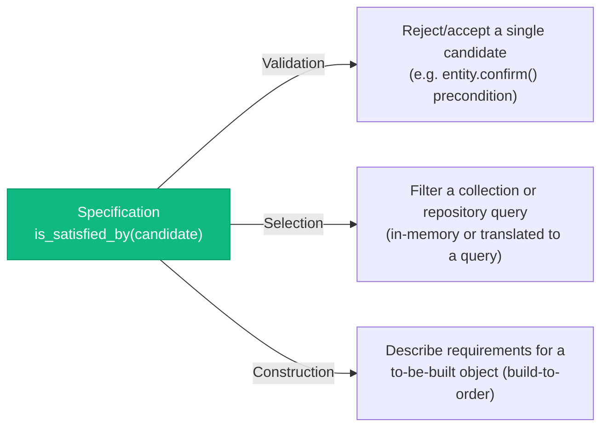

# Specification Pattern

> Sources:
> - [Domain-Driven Design: The Blue Book](https://www.domainlanguage.com/ddd/blue-book/) — Eric Evans (2003), ch. 9
> - [Specifications](https://www.martinfowler.com/apsupp/spec.pdf) — Eric Evans & Martin Fowler (2002)
> - [Implementing Domain-Driven Design](https://openlibrary.org/works/OL17392277W) — Vaughn Vernon (2013)

A **Specification** wraps a business rule or predicate ("is this candidate valid /
selected / needed?") into its own object instead of scattering the same `if` chain
across a validation method, a query, and a factory. It answers one question:
`is_satisfied_by(candidate) -> bool`.

## When to Use (and When NOT to)

| Use When                                                          | Skip When                                       |
| ------------------------------------------------------------------ | ------------------------------------------------ |
| The same business rule is checked in 2+ places (validate, select, build-to-order) | The rule is used exactly once, inline            |
| The rule combines multiple conditions with AND/OR/NOT logic        | It's a single attribute comparison               |
| The rule needs to be named and unit-tested on its own              | It's trivial enough that naming it adds no clarity |
| Domain experts have a name for the rule ("OverdueOrder", "EligibleForDiscount") | There's no ubiquitous-language term for it — you're inventing one just to have a class |

**Default to a plain `if` or a query filter first.** A Specification earns its place
only when the *same* predicate is reused across contexts (e.g. "is this order
overdue?" checked when confirming an order, when selecting overdue orders for a batch
job, and when a Domain Service decides whether to build a follow-up task). One-off
checks that stay one-off are not a smell — don't pre-build a Specification for a rule
that might get reused someday.

## The Three Uses (Evans)



1. **Validation** — check a candidate object satisfies a rule before an operation proceeds.
2. **Selection** — pick matching objects out of a collection (in-memory) or a repository.
3. **Construction (build-to-order)** — describe what a newly created object must satisfy, so a factory can build exactly that.

A single Specification class can serve all three; which use you're in depends only on
*how the caller uses the boolean/filter*, not on the Specification's own code.

## Where It Lives

Specifications are domain objects — pure predicates over Entities/Value
Objects/Aggregates, with no I/O and no framework dependency, same rule as everything
else in `domain/`. The composable base is a generic domain abstraction, so it lives in
the shared kernel; concrete specifications belong to the context whose language names them.

```text
app/
├── shared_kernel/domain/specifications/
│   └── specification.py                    # ISpecification[T] Protocol + Specification[T] base
└── bounded_context/ordering/domain/
    ├── entities/order.py
    ├── enums/order_status_enum.py
    ├── value_objects/money.py
    └── specifications/
        └── overdue_order_specification.py  # concrete specification(s)
```

Create `specifications/` only when the context has a specification to put in it.

## Pattern

```python
# app/shared_kernel/domain/specifications/specification.py
"""Base Specification protocol and composable combinators."""

from __future__ import annotations  # methods annotate with their own class

from typing import Protocol


class ISpecification[T](Protocol):
    """What a caller depends on: a named business predicate over a candidate of type T."""

    def is_satisfied_by(self, candidate: T) -> bool:
        """Return True if candidate satisfies this specification."""
        ...


class Specification[T]:
    """Base class providing the AND/OR/NOT combinators via composition.

    Concrete specifications inherit this and implement only
    `is_satisfied_by` — the combinators are free.
    """

    def is_satisfied_by(self, candidate: T) -> bool:
        raise NotImplementedError

    def and_(self, other: ISpecification[T]) -> Specification[T]:
        return _AndSpecification(self, other)

    def or_(self, other: ISpecification[T]) -> Specification[T]:
        return _OrSpecification(self, other)

    def not_(self) -> Specification[T]:
        return _NotSpecification(self)


class _AndSpecification[T](Specification[T]):
    def __init__(self, left: ISpecification[T], right: ISpecification[T]) -> None:
        self._left = left
        self._right = right

    def is_satisfied_by(self, candidate: T) -> bool:
        return self._left.is_satisfied_by(candidate) and self._right.is_satisfied_by(candidate)


class _OrSpecification[T](Specification[T]):
    def __init__(self, left: ISpecification[T], right: ISpecification[T]) -> None:
        self._left = left
        self._right = right

    def is_satisfied_by(self, candidate: T) -> bool:
        return self._left.is_satisfied_by(candidate) or self._right.is_satisfied_by(candidate)


class _NotSpecification[T](Specification[T]):
    def __init__(self, spec: ISpecification[T]) -> None:
        self._spec = spec

    def is_satisfied_by(self, candidate: T) -> bool:
        return not self._spec.is_satisfied_by(candidate)
```

The combinators return the private classes defined later in the module. With postponed
annotations, and names resolved when the method runs, the forward use is safe.

```python
# app/bounded_context/ordering/domain/specifications/overdue_order_specification.py
"""Specifications for Order overdue/eligibility rules."""

from datetime import datetime, timedelta
from decimal import Decimal

from app.bounded_context.ordering.domain.entities import Order
from app.bounded_context.ordering.domain.enums import OrderStatusEnum
from app.bounded_context.ordering.domain.value_objects.datetime import Datetime
from app.shared_kernel.domain.specifications import Specification

_OVERDUE_AFTER = timedelta(hours=48)


class OverdueOrderSpecification(Specification[Order]):
    """An order is overdue if placed more than 48h ago and not yet shipped.

    `now` is injected so the predicate stays pure and deterministic.
    """

    def __init__(self, now: datetime) -> None:
        self._now = now

    def is_satisfied_by(self, candidate: Order) -> bool:
        if candidate.placed_at is None:
            return False
        overdue = self._now - candidate.placed_at.value > _OVERDUE_AFTER
        return overdue and candidate.status is OrderStatusEnum.PLACED


class HighValueOrderSpecification(Specification[Order]):
    """An order qualifies as high-value at or above a configurable threshold."""

    def __init__(self, threshold: Decimal = Decimal("500")) -> None:
        self._threshold = threshold

    def is_satisfied_by(self, candidate: Order) -> bool:
        return candidate.total.amount >= self._threshold


# Composition — no new class needed for "overdue AND high-value"
# (`now` comes from the caller, e.g. a clock port in the application layer)
overdue_and_high_value = OverdueOrderSpecification(now=now).and_(HighValueOrderSpecification())
```

### Use 1 — Validation

```python
# app/exceptions/ordering_errors.py
class OrderNotEligibleForEscalationError(DomainException):
    __error_code__ = "ORD-210"

    def __init__(self, order_id: str) -> None:
        super().__init__(
            f"Order '{order_id}' does not meet the escalation rule.",
            metadata={"order_id": order_id},
        )


# app/bounded_context/ordering/domain/entities/order.py (excerpt)
from __future__ import annotations  # `ISpecification[Order]` names the class being defined

from app.shared_kernel.domain.specifications import ISpecification


@dataclass(slots=True, kw_only=True, eq=False)
class Order(AggregateRoot[OrderId]):
    escalated: bool = False

    def escalate(self, spec: ISpecification[Order]) -> None:
        """Escalate the order if it satisfies the given specification."""
        if not spec.is_satisfied_by(self):
            raise OrderNotEligibleForEscalationError(str(self.id))
        self.escalated = True
```

### Use 2 — Selection (in-memory)

```python
# app/bounded_context/ordering/domain/services/escalation_service.py
class EscalationService:
    """A Domain Service filtering an already-loaded collection."""

    def __init__(self, spec: ISpecification[Order]) -> None:
        self._spec = spec

    def find_orders_to_escalate(self, orders: list[Order]) -> list[Order]:
        return [order for order in orders if self._spec.is_satisfied_by(order)]
```

### Use 2 — Selection (repository-translated)

Translating a Specification straight into a SQL/ORM filter (a visitor per spec, or a
`to_sqlalchemy_filter()` method) is a legitimate but heavier technique — **only worth it
when the same rule genuinely needs to run both in-memory and as a query**. Don't reach
for it by default:

```python
# app/bounded_context/ordering/domain/repositories/i_order_repository.py — still a domain port
class IOrderRepository(abc.ABC):
    @abc.abstractmethod
    async def find_satisfying(self, spec: ISpecification[Order]) -> list[Order]: ...


# app/bounded_context/ordering/infrastructure/outbound/persistence/repositories/sql_order_repository_adapter.py
class SqlOrderRepositoryAdapter(IOrderRepository):
    async def find_satisfying(self, spec: ISpecification[Order]) -> list[Order]:
        # Simplest correct implementation: load candidates, filter in Python.
        # Only optimize into a translated SQL WHERE clause once this path is a
        # measured bottleneck — premature query-translation is the anti-pattern below.
        candidates = await self._load_candidates()
        return [order for order in candidates if spec.is_satisfied_by(order)]
```

**This is not the same thing as CQRS read-side filtering.** A query handler's filter
params (`status`, `customer_id`, pagination) belong on the `Query` and get pushed
straight into a read repository's SQL (see [CQRS events](../cqrs/events.md) and
[CQRS implementation](../cqrs/implementation.md)) — those aren't reusable domain business
rules, they're request shape, whether the request came from an API, a CLI, or a worker.
Don't wrap ordinary query filters in a Specification just for consistency; reserve
Specification for a *named business rule* that Domain code also needs to evaluate outside
the query path.

### Use 3 — Construction (build-to-order)

```python
# app/exceptions/ordering_errors.py
class OrderSpecificationNotMetError(DomainException):
    __error_code__ = "ORD-211"

    def __init__(self, order_id: str) -> None:
        super().__init__(
            f"Order '{order_id}' does not satisfy the required specification.",
            metadata={"order_id": order_id},
        )


# app/bounded_context/ordering/domain/services/order_factory.py
class OrderFactory:
    """Builds an order guaranteed to satisfy a given specification."""

    def create_matching(
        self,
        customer_id: CustomerId,
        spec: ISpecification[Order],
    ) -> Order:
        order = Order.create(customer_id=customer_id)
        if not spec.is_satisfied_by(order):
            raise OrderSpecificationNotMetError(str(order.id))
        return order
```

Both errors are `DomainException` subclasses, never `ValueError`: see the
[error model](../errors/error-model.md).

## Testing

Specifications are pure predicates — no I/O, no mocking, trivially parametrized:

```python
# tests/unit/bounded_context/ordering/domain/test_overdue_order_specification.py
from datetime import UTC, datetime, timedelta

import pytest

from app.bounded_context.ordering.domain.enums import OrderStatusEnum
from app.bounded_context.ordering.domain.value_objects.datetime import Datetime
from app.bounded_context.ordering.domain.specifications.overdue_order_specification import (
    OverdueOrderSpecification,
)

from tests.builders.order_builder import OrderBuilder

NOW = datetime(2026, 1, 15, 12, tzinfo=UTC)


@pytest.mark.parametrize(
    ("hours_since_placed", "status", "expected"),
    [
        (49, OrderStatusEnum.PLACED, True),
        (47, OrderStatusEnum.PLACED, False),
        (72, OrderStatusEnum.SHIPPED, False),
    ],
)
def test_overdue_order_specification(
    hours_since_placed: int,
    status: OrderStatusEnum,
    expected: bool,
) -> None:
    placed_at = Datetime(value=NOW - timedelta(hours=hours_since_placed))
    builder = OrderBuilder().with_item().placed(at=placed_at)
    order = (builder.shipped() if status is OrderStatusEnum.SHIPPED else builder).build()
    assert OverdueOrderSpecification(now=NOW).is_satisfied_by(order) is expected
```

`OrderBuilder` builds the aggregate through its own behaviour (`add_item`, `place` with an
injected clock, `ship`/`cancel`), never by assigning fields; see the
[testing strategy](../testing/strategy.md) for the builder conventions.

## Anti-Patterns

| Anti-Pattern                              | Problem                                                    | Fix                                                          |
| ------------------------------------------ | ----------------------------------------------------------- | -------------------------------------------------------------- |
| **Specification for a one-off check**      | Adds indirection with no reuse payoff                       | Keep it a plain `if`/boolean expression until reused          |
| **Specification wrapping a query filter**  | Confuses CQRS read-side shape with a domain business rule   | Query params stay on the `Query`; see [CQRS events](../cqrs/events.md) |
| **Specification with I/O inside**          | `is_satisfied_by` calling a repository, network client, or the system clock breaks purity and testability | Pass already-loaded data (and `now`) in; keep the spec pure   |
| **Giant one-class specification**          | One `is_satisfied_by` with unrelated AND'd conditions bolted in ad hoc | Split into small named specs, compose with `.and_()`/`.or_()` |
| **Naming without ubiquitous language**     | `Spec1`, `CheckA` — no domain meaning                        | Name it what the domain expert calls the rule, or don't extract it |

## Reference Documentation

- [DDD tactical patterns](../ddd/tactical-patterns.md) — Entity, Value Object, Aggregate, Repository, Domain Service, UoW, Factory
- [CQRS events](../cqrs/events.md) — why query filters are not Specifications
- [error model](../errors/error-model.md) — typed domain errors raised when a specification is not met
- [testing strategy](../testing/strategy.md) — domain object test fixtures

## Review Checklist

- [ ] A Specification exists only for a named, reused business rule (2+ uses), not a one-off check or an ordinary query filter.
- [ ] Its name comes from the ubiquitous language.
- [ ] The composable base lives in `shared_kernel/domain/specifications/`; concrete specifications live in the owning context's `domain/specifications/`.
- [ ] `is_satisfied_by` is pure: no repository, network, or clock access; time is injected.
- [ ] Callers depend on `ISpecification[T]`; combinations use `.and_()`, `.or_()`, `.not_()` instead of new ad hoc classes.
- [ ] A failed validation or construction raises a typed `DomainException` subclass, never `ValueError`.
- [ ] Repository translation of a specification into SQL exists only for a measured need, inside the infrastructure adapter.
